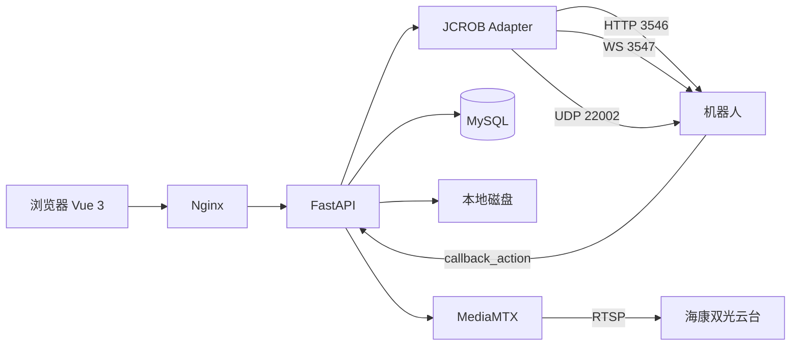

# 以 JCROB PDF SDK 为唯一依据的平台方案

> 2026-10-20 · 唯一原厂资料：`API接口导航2024_HTTP_20240619142112(1).pdf`（109 页）
>
> 本文的能力、字段、接口名全部来自这份 PDF；xlsx、UI 照片、demo 源码、`项目架构.txt` 不作为机器人能力依据。

## 0. 先回答：`/system/info` 是文档里的，还是我编的

**是 PDF 原文，第 9 页。** 原文摘录：

```text
获取系统基本信息
URL:/system/info
请求方式:GET
请求参数:无
返回参数:
battery int 电池电量百分比
camera_rgb int rgb摄像头topic发布频率...
odom int 编码器topic发布频率...
imu int IMUtopic的发布频率...
driver_port bool 急停按钮状态，true为按下，false为未按下
charge bool 是否正在执行充电任务
loop bool 是否正在执行循环任务
info object 机器人基本信息
```

第 10 页的示例返回里还有 `version`、`code_name`、`id`、`mac`、`port`、`slam_type`。

### 这些接口名是怎么提取的

不是凭记忆写的。过程是可复现的：

1. 用 `pdfplumber` 打开 PDF，逐页调用 `extract_text()`；
2. 匹配以 `URL:` 开头的行，同时向下找 `请求方式:`；
3. 记录 PDF 物理页码、方法、URL、原文标题；
4. 结果共 **178 条 URL**，全部在 [PDF接口原文索引.md](PDF接口原文索引.md)；
5. 脚本在 `scripts/extract_pdf_endpoints.py`，可以自己重跑。

### 但有三类东西不是 PDF 原文，必须分清

| 类型 | 例子 | 性质 |
|---|---|---|
| PDF 原文接口 | `/system/info`、`/navigation/loop_task`、`/system/onvif_camera/temperature` | 可直接引用，带页码 |
| 我对 URL 的规范化 | 曾把 `/navigation/move to index` 写成 `/navigation/move_to_index` | **我的错，已改回原文并标注** |
| 平台自建 API | `/api/v1/robots/{id}/status`、`/api/v1/tasks` | 我设计的平台接口，PDF 里没有 |
| 我对单位/语义的推断 | `nav_points.theta` 像弧度；`currentAngle` 单位未写 | 推断，必须实机验证 |

## 1. SDK 的真实能力地图（按 PDF 页码）

### 1.1 接入与身份

| 能力 | 接口 | 页码 | 备注 |
|---|---|---:|---|
| 获取 token | `GET /token` | 8 | 参数 `username`、`password` |
| UDP 发现 | 端口 22002 广播 | 7 | 返回 `id/port/mac/version` |
| HTTP 服务 | 默认 3546，前缀 `/api/v1` | 7 | GET/DELETE 参数在 query，POST/PUT 在 body |
| WebSocket | 默认 3547，`ws://ip:3547/topicName?token=...` | 106 | 需每秒发 `ping` |

### 1.2 状态与健康

| 能力 | 接口 | 页码 | 关键字段 |
|---|---|---:|---|
| 系统互斥状态 | `GET /system/status` | 9 | `Mapping/Navigating/Busy/Free` |
| 基本信息 | `GET /system/info` | 9–10 | `battery`、`driver_port`（急停）、`charge`、`loop`、`info.version`、`slam_type` |
| 导航细状态 | `GET /system/galileo_status` | 10–11 | `navStatus`、`visualStatus`、`mapStatus`、`chargeStatus`、`loopStatus`、`power`、`targetStatus`、`targetDistance`、`controlSpeedX/Theta`、`currentSpeedX/Theta`、`currentPosX/Y/currentAngle`、`busyStatus` |
| 速度 | `GET /system/speed` | 11 | `speed_x`、`speed_y`、`speed_angle`（rad/s） |
| 自检 | `GET /system/self_test` | 16–17 | `motor_driver`、`camera`、`charge`、`lidar`、`bluetooth`、`battery` |
| 日志 | `GET /system/log` | 11 | 文本日志 |

### 1.3 地图与定位

| 能力 | 接口 | 页码 | 关键点 |
|---|---|---:|---|
| 开始/停止建图 | `GET /map/start`、`GET /map/stop` | 53 | 平台不做 SLAM，只触发 |
| 更新地图 | `GET /map/update` | 53–54 | 雷达导航需要 `start_index` |
| 当前位姿 | `GET /map/pose` | 54 | `x/y` 米，`angle` **度** |
| 当前建图信息 | `GET/POST /map/current_map_image` | 54–55 | 含 `origin`、`resolution`、`width`、`height` |
| 当前建图 PNG | `GET /map/current_map_png` | 56 | PNG |
| 运动轨迹 | `GET /map/track` | 56 | 建图轨迹 |
| 已保存地图 | `GET /navigation/saved_maps` | 60–61 | `name`、`type`（camera/lidar/all） |
| 地图 PNG | `GET /navigation/map_png` | 62 | 参数 `name` |
| 当前地图 | `GET /navigation/current_map` | 62 | 当前使用的地图 |
| 导航位姿 | `GET /navigation/pose` | 59–60 | `x/y` 米，`angle` **度** |

坐标换算原文（第 54–55 页）：

```text
像素原点在图片左上角，x 向右，y 向下；
地图原点在左下角，x 向右，y 向上。
x_map = x_origin + x_pixel * res
y_map = y_origin + h_map * res - y_pixel * res
```

### 1.4 导航与巡航

| 能力 | 接口 | 页码 | 关键参数 |
|---|---|---:|---|
| 启动导航 | `GET /navigation/start` | 57–58 | `map`、`path`、`start_index`（雷达必填，-1=充电桩） |
| 停止导航 | `GET /navigation/stop` | 59 | — |
| 当前地图/路径 | `GET /navigation/current_path` | 60 | `map`、`path` |
| 到目标点距离 | `GET /navigation/target_distance` | 60 | 米 |
| 启动已保存任务 | `POST /navigation/start_nav_task` | 65 | 任务对象 |
| 自动充电 | `GET /navigation/go_charge` | 66 | 充电任务 |
| 停止充电 | `GET /navigation/stop_charge` | 67 | — |
| 移动到指定点 | `GET /navigation/move to index` | 67 | **原文含空格**；`index`、`map`、`path`、`level` |
| 取消导航任务 | `GET /navigation/stop_nav_task` | 67 | — |
| 循环巡航 | `GET/POST/DELETE /navigation/loop_task` | 68 | POST 只有 `wait_time` |
| 充电桩位姿 | `GET/POST /navigation/charge_pose` | 68–69 | — |
| 路径增删改查 | `GET/POST,PUT/DELETE /navigation/path` | 70–71 | — |
| 导航点增删改查 | `GET/POST,PUT/DELETE /navigation/nav_points` | 72–73 | 格式 `x y z theta errorX errorY direction name` |
| 连接点 | `/navigation/point_connections` | 73–76 | 跨地图/跨楼层 |
| 切换地图 | `GET /navigation/switch_map` | 76 | — |
| 忽略区 | `/navigation/skip_area` | 77–78 | — |
| 虚拟墙 | `/navigation/virtual_wall` | 78–79 | — |
| 初始位姿 | `POST /navigation/init_pose` | 80 | — |
| 多地图任务 | `/navigation/multi_map_task` | 80 | 只生成，不执行 |
| 局部运动 | `GET /navigation/start_local_move` | 81 | `distance` 米、`angle` **弧度** |
| 导航+局部运动 | `/navigation/start_nav_and_local_move` | 81–82 | — |
| 导航+局部+IO | `/navigation/start_nav_local_move_io` | 82 | — |
| 局部到点/索引 | `/navigation/start_local_move_target`、`start_local_move_index` | 82–83 | — |

**巡航的两种实现**：

1. `POST /navigation/loop_task {wait_time}`：沿当前路径的导航点依次走，最简单，适合固定路线；
2. `POST /task`，`sub_tasks` 里放多个 `nav_action`，再加 `sleep_action`、`image_action`、`tts_action`：适合“到点拍照/播报/等待”的业务巡检。

### 1.5 任务与动作

| 能力 | 接口 | 页码 |
|---|---|---:|
| 任务 CRUD | `GET/POST/PUT/DELETE /task` | 86–88 |
| 启动/暂停/继续/取消/循环 | `/task/start`、`pause`、`resume`、`stop`、`loop` | 88–89 |
| 动作 CRUD | `GET/POST/PUT/DELETE /action` | 89–97 |
| 等待请求 | `GET /action/update_wait_req` | 97 |
| 自动化任务 | `/blockly_task` | 98–99 |

任务对象字段（第 87 页示例）：`name`、`loop_flag`、`id`、`state`、`sub_tasks`、`progress`、`current_task`。

Action 类型（第 90–96 页）：

```text
callback_action         回调平台指定 URL
sleep_action            等待 wait_time 秒
nav_action              导航到 x/y/theta
charge_action           充电
local_move_action       局部运动
wait_req_action         等待外部请求
switch_map_action       切换地图
change_setting_action   改系统设置
roslaunch_action        启动 ROS 程序
io_action               控制 IO
elevator_req_action     电梯请求
none_stop_nav_action    到点不停车
blockly_action          执行自动化任务
video_record_action     录制视频
image_action            拍照
tts_action              语音合成
onvif_camera_move_action / onvif_camera_snapshot_action
slide_action / jacking_action / jacking_rotate_action
local_move_target_action
```

**关键点**：`callback_action` 让机器人执行到某一步时主动调用平台 URL。它不是持续状态推送，但可以做“到点已拍照”“任务段完成”的检查点通知；其余状态用 `/task` 轮询。

### 1.6 视频、云台、测温

| 能力 | 接口 | 页码 | 说明 |
|---|---|---:|---|
| 发现摄像头 | `GET /system/onvif_cameras` | 42–43 | 返回局域网 IP/端口 |
| 摄像头参数 | `GET /system/onvif_cameras` | 42–43 | 传 `ip/port/username/password` |
| 取 RTSP 流 | `GET /system/onvif_camera/stream` | 44 | 返回 `stream` 地址 |
| 绝对移动 | `GET /system/onvif_camera/move` | 45 | `x/y/zoom` |
| 预置点 | `GET /system/onvif_camera/goto_preset` | 45 | `preset` |
| 速度移动 | `GET /system/onvif_camera/move_speed` | 46 | 连续控制用 |
| 抓拍 | `GET /system/onvif_camera/snapshot` | 46 | 返回文件位置 |
| 测温 | `GET /system/onvif_camera/temperature` | 47 | **需摄像头支持红外测温且支持海康 ISAPI** |
| 云台位姿 | `GET /system/onvif_camera/pose` | 48 | — |

### 1.7 录像、文件、IO、语音

| 能力 | 接口 | 页码 |
|---|---|---:|
| 拍照 | `POST /system/saved_images` | 34 |
| 照片列表/删除 | `GET/DELETE /system/saved_images/` | 34–35 |
| 开始录像 | `POST /system/saved_videos` | 35 |
| 录像列表/删除 | `GET/DELETE /system/saved_videos/` | 35–36 |
| 文件系统 | `/fs/file_api`、`/fs/dir_api`、`/fs/get_file_info`、`/fs/copy`、`/fs/delete`、`/fs/cut` | 49–52 |
| IO 输出（3 路） | `GET/POST /system/io` | 17 |
| IO 扩展（8 进 8 出） | `GET/PUT /system/bw_io` | 18 |
| 语音 | `/system/tts`、`/system/tts/playing`、`/system/tts/stop`、`/system/tts/records` | 24–29 |

## 2. 平台能做什么（只从 SDK 推导）

### P0：首版必须有

1. **实时驾驶舱**：`status`、`battery`、`driver_port`（硬件急停）、`charge`、`loop`、`power`、位姿、速度、导航/视觉/充电状态、环境 WS。
2. **地图与点位**：保存地图列表、PNG 底图、`nav_points`、`path`、`point_connections`、`virtual_wall`、`skip_area`、`switch_map`。
3. **任务编排**：创建 `task`（`sub_tasks` 为 `nav_action`/`sleep_action`/`image_action`/`tts_action`），启动/暂停/继续/停止，展示 `progress`/`current_task`。
4. **固定巡航**：`loop_task`，或“导航点序列 + 到点动作”的任务。
5. **告警**：平台根据环境 WS（`lel`、`smoke`、`temperature` 等）、`self_test`、`driver_port`、任务状态推导；SDK 没有结构化告警接口。
6. **历史与审计**：平台库记录任务、告警、操作、位姿采样；SDK 只提供当前状态和文件。
7. **权限**：平台自建用户/角色；SDK 只有 token，不提供 RBAC。

### P1：真机验证后再开

- **视频/云台/测温：本期不做，后续单独接**；接口在 PDF 42–48 页，等明确型号后再启用；
- 录像：`video_record_action` 或 `POST /system/saved_videos`，按任务/告警触发，不做 7×24；
- 遥控：`PUT /system/speed`（5Hz 左右）或 6.2.1+ 的 WS `cmd_vel`；
- IO：`/system/io` 三路输出、`/system/bw_io` 八进八出；
- 语音播报：`tts_action`；
- 跨地图/电梯：`point_connections` + `elevator_req_action`；
- 自动化：`blockly_task`，先只读，不首版自建编辑器；
- 校准/升级/配置：`/system/calibrate_*`、`/system/update/*`、`/system/config`，放“维护”菜单并限管理员。

### 明确不做（SDK 没有）

| 需求 | SDK 现状 | 结论 |
|---|---|---|
| 15 串 BMS 单体电压 | 只有 `battery` 百分比和 `power` 电压 | 做不了，除非外接 BMS |
| 结构化告警接口 | 无 | 平台规则推导 |
| AI 表计/缺陷识别 | 无 | 外接 AI 服务，P2 |
| MQTT / GB28181 | 无 | 不引入 |
| 软件急停 | 只有 `driver_port` 读取硬件急停状态 | 平台“停止”=取消任务，不是安全急停 |
| 多机器人调度 | `schedule_manager` 是外部调度服务器 | 本期单机 |
| 7×24 录像 | 有开始/停止录像能力，但机器人电池供电 | 按任务/告警触发 |
| 用户/角色/报表 | 无 | 平台自建 |

## 3. 平台架构（工程选择，不是 PDF 内容）



Adapter 只做四件事：token、HTTP/WS 连接、单位归一化、能力探测。业务层不直接拼 JCROB 的 URL。

## 4. 真机第一轮必须确认的 12 件事

1. `info.version`、`slam_type`、`info.port`；
2. `/system/status` 四个状态的实际切换；
3. `galileo_status` 全部枚举和 `currentAngle` 单位；
4. `/navigation/pose` 与 `/map/pose` 在同一位置的读数，验证坐标系和角度；
5. `/navigation/saved_maps` + `map_png` + `origin/resolution/width/height`；
6. `nav_points` 的 `theta` 单位（样例像弧度）；
7. `loop_task` 的 `wait_time` 语义、失败/中断表现；
8. `/task` 创建/启动/暂停/停止的同步性、`progress`、`current_task`；
9. `callback_action` 能否从机器人访问平台（网络方向、method、data）；
10. `/system/onvif_camera/stream` 返回的 RTSP 能否被 MediaMTX 拉取；
11. `/system/onvif_camera/temperature` 是否返回温度（海康 ISAPI 前提）；
12. `driver_port` 急停状态、`/system/self_test` 各项、实际续航。

## 5. 六周 MVP（按 SDK 能力裁剪）

| 周 | 交付 |
|---|---|
| 1 | FastAPI + Vue 骨架、登录、设备配置、探针夹具 |
| 2 | 驾驶舱：状态/电量/急停/位姿/环境 WS |
| 3 | 地图与点位：地图列表、PNG、nav_points/path、坐标换算 |
| 4 | 任务：创建/启动/暂停/停止、`loop_task`、`callback_action` |
| 5 | 告警规则、历史查询、CSV 导出、审计、系统设置 |
| 6 | 真机联调、异常处理、部署、验收 |

如果第 1 周拿不到真机，状态和任务都只能做 Mock，不能宣称“已联调”。

## 6. 当前待确认

1. 机器人能否反向访问平台（`callback_action` 需要一个平台可达的 URL）？
2. 现场安全员能否给出 `lel`、`smoke`、`temperature` 的报警阈值？
3. 是否确认本期不做视频/云台，后续单独接？

固件版本接入时记录即可，不作为开发前置条件；`info` 字段要 4.5.0/5.1.0 之后才有，WS `cmd_vel` 要 6.2.1+，能力探测会自动处理。
