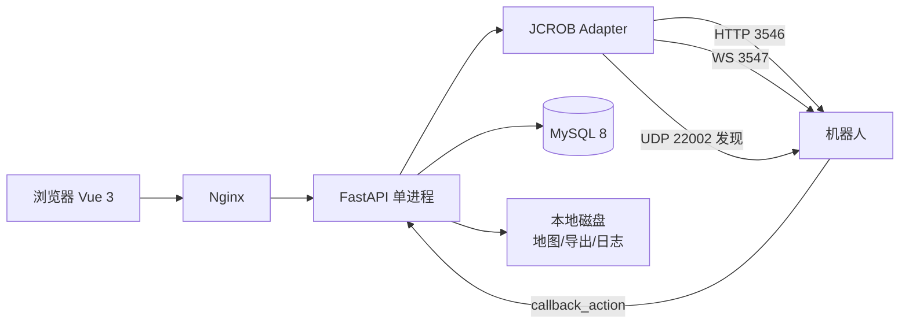

# 防爆机器人平台 — 平台方案定稿

> 2026-10-20 · v1.1 · 唯一机器人能力依据：JCROB HTTP/WS PDF（109 页）
>
> 本期范围：平台 + SDK 接入。视频、云台、测温全部后置。
>
> 版本未知：不按固件版本写死功能，启动时做能力探测，缺什么就隐藏/置灰。
>
> 交付日：**2026-12-01**。部署目标机：`192.168.8.40`（Ubuntu 22.04 + Docker Compose）。
>
> v1.1 修订（逐条对应 PDF 原文与实机联调口径）：
>
> 1. `move to index` 按原文发送（空格编码为 `%20`），不做 URL 规范化；兼容别名只在 404/405 时启用；
> 2. `get_config` 进 Adapter，但是白名单脱敏只读，`wifi_password` 一类字段不落盘、不过前端；
> 3. `/system/is_online` 不是平台在线判定，降为公网链路诊断；
> 4. token 改为事件驱动（启动取一次 + 401/403 或明确鉴权失败时重取），不做未经证实的定时轮换；
> 5. `currentAngle` 的单位用多帧圆周误差判定，不用单帧比值；
> 6. `busyStatus` 不放宽，写操作闸门保持严格；
> 7. “停止”默认带 `jcrob_task_id`，“取消全部任务”单列为危险操作；
> 8. 机器人回调改为 run token，删除 HMAC Header 方案（PDF p90 只允许填 url/method/data）；
> 9. 嵌套 `sub_tasks`（行为树，PDF p101–105）是已定义能力：平台只产出扁平 action，读取必须容错；
> 10. `progress` 单位未知，UI 不显示百分比进度条。

## 1. 目标与边界

### 1.1 本期目标

一台 JCROB 轮式防爆机器人、一个场站、一张地图、一条固定路线，做到：

1. 实时看到机器人状态、位姿、电量、急停、充电、导航状态；
2. 在地图上管理点位和路径；
3. 创建并下发巡检任务，能暂停、继续、停止；
4. 按环境数据和设备状态产生告警；
5. 查历史、导出、审计；
6. 所有机器人调用只经过一个 Adapter，后续换固件只改这一层。

### 1.2 本期不做

| 项 | 原因 |
|---|---|
| 视频、云台、测温（海康） | 本期明确后置；后续单独接 ONVIF/RTSP。机器人自带相机的 `image_action` 抓拍不受此限制 |
| 15 串 BMS 单体电压 | PDF 只有 `battery` 百分比和 `power` 电压 |
| 结构化告警接口 | PDF 没有，平台按规则推导 |
| AI 表计/缺陷识别 | PDF 没有 |
| MQTT / GB28181 | PDF 没有 |
| 软件急停 | PDF 只有 `driver_port` 读取硬件急停状态，没有急停下发接口 |
| 多机器人调度 | PDF 的 `schedule_manager` 是外部调度服务器，不是车队管理 |
| 7×24 录像 | 机器人电池供电，本期不做 |

### 1.3 验收口径

不以“页面画出来”为完成，以“真机数据驱动 + 任务状态可追踪 + 写操作可审计”为完成。

## 2. 角色与权限

| 角色 | 权限 |
|---|---|
| 管理员 | 设备连接配置、用户/角色、阈值、全部任务与告警 |
| 操作员 | 查看、创建/下发任务、暂停/继续/停止、确认告警 |
| 只读 | 查看驾驶舱、地图、任务、告警、历史 |

权限做到菜单 + 按钮级即可，不做多租户、不做数据行级权限。

## 3. 总体架构



### 3.1 进程模型

一个 FastAPI 进程（`uvicorn --workers 1`），进程内跑四个后台任务：

| 后台任务 | 频率 | 职责 |
|---|---|---|
| `status_poller` | 1s | `/system/status`、`/system/galileo_status`；WS 正常时位姿以 WS 为主，HTTP 轮询做兜底和一致性校验 |
| `task_reconciler` | 2s | 有活动任务时查 `/task?id=`，对账状态 |
| `ws_listener` | 长连接 | `/galileo/status`、两个环境 topic，每秒 `ping` |
| `retention_job` | 每天 | 清理过期采样、导出、日志 |

**单 worker 是刻意选择**：状态缓存、WS 连接、后台循环都在进程内，避免为了多实例引入 Redis。将来要多副本，再把后台任务拆成独立 worker。

**单进程的三条纪律**（模型评审后补，2026-10-20）：

1. 每个后台循环必须包在 supervisor 里，异常后自动重启并上报存活时间；否则某个循环静默死掉（比如 `ws_listener` 挂了只剩 HTTP），页面还在装正常；
2. 暴露事件循环延迟指标（`loop_lag_ms`），持续 > 100ms 视为异常——任何同步阻塞（读大 PNG、导出 Excel、同步 MySQL 驱动）都会在这里先露头；
3. 缓存的“新鲜度”一律用**服务端接收时间 `recv_ts`**，不用机器人报文里的时间戳（电池设备的 NTP 状态未知）。所有“超过 3s 未更新”的判断都基于 `recv_ts`。

### 3.2 部署

```text
docker compose:
  server   FastAPI
  mysql    MySQL 8
  nginx    静态前端 + /api 反代
```

三个容器起步。没有 Redis、MinIO、EMQX、TDengine、XXL-Job、ELK、MediaMTX。

目标机 `192.168.8.40` 的实测约束（2026-10-20 只读核对）：

| 项 | 实测 | 对部署的要求 |
|---|---|---|
| OS / Docker | Ubuntu 22.04.5，Docker 29.5.3 + Compose v5.1.4 | 直接用 compose，无额外依赖 |
| 已在跑 | 52 个容器（CVAT/Dify/FastGPT/n8n/o2oa/Traefik/Portainer…） | **全部资源加 `jc-` 前缀**，compose 项目名单独起 |
| 端口 | 80/443/8080/8082/8086/8890/3000s/5001/5678 已占 | nginx 用 **8099**（实测空闲）；server/mysql 不发布宿主端口 |
| MySQL | 已有 `mysql:8.4.4` 容器占着 3306 | **不复用**；自起 `jc-mysql`，只在 compose 网络内可达 |
| 磁盘 | `/` 剩 377G，`/data` 剩 1.9T，`data-root=/data/docker` | 数据落 `/data/jcrob-platform/data/{mysql,uploads,exports,logs}` |
| 工具链 | 无 pnpm | 前端在 Docker 多阶段构建里用 corepack，不动宿主 |
| 网络 | `eno1` 192.168.8.40/24、`eno2` 192.168.1.248/24 | 机器人接哪段待现场确认；两块网段都通 |
| 时区 | Asia/Shanghai，NTP 已同步 | 与 §12 一致 |

补充三条部署纪律：

- **资源限额**：`jc-server` 限 1 核 / 1G，`jc-mysql` 限 2 核 / 2G，并显式设 `innodb_buffer_pool_size`（不给限额时 MySQL 容易吃满内存被 OOM kill，连累邻居）；
- **镜像预拉**：交付前一周把 `python:3.12-slim`、`mysql:8.4.4`、`nginx:alpine` 全部拉好并存档，演示当天不拉镜像；
- **安静窗口**：演示当天向宿主管理员确认没有批量推理任务，load 28 的机器上被邻居挤爆是真实风险。

## 4. 技术选型

| 层 | 选择 | 说明 |
|---|---|---|
| 前端 | Vue 3 + TypeScript + Vite + Pinia + Vue Router | 组件库暂不引入：一期用自写组件 + CSS 变量（`web/src/styles/tokens.css`）。真要换组件库时按需引入，别装全量 |
| 图表 | ECharts | W5 画历史曲线时再装；现在没有曲线，不预先背这个包 |
| 地图 | Canvas + PNG 底图 | 单张室内栅格图，不需要 Leaflet |
| 后端 | FastAPI + Pydantic v2 | 类型契约、OpenAPI、异步 I/O |
| ORM | SQLAlchemy 2.x + Alembic | 迁移从第一天开始 |
| 调度 | 进程内 asyncio 任务 | 不引 APScheduler 也可以；需要 cron 再加 |
| 数据库 | MySQL 8 | 业务 + 采样 + 审计 |
| 认证 | JWT（httpOnly Cookie）+ CSRF | 平台自己的账号体系 |
| 部署 | Docker Compose + Nginx | 单机 |

工程选择不是 PDF 内容；换 Spring Boot 不影响 SDK 契约和数据表。

## 5. JCROB Adapter（核心）

### 5.1 配置

```yaml
jcrob:
  base_url: http://192.168.x.x:3546
  ws_url: ws://192.168.x.x:3547
  username: ...
  password: ...
  token: ""            # 可预置；为空则用账号换
  http_timeout_s: 3
  poll_interval_s: 1
  task_poll_interval_s: 2
```

### 5.2 认证

- `GET /token?username=&password=` 换 token；
- token 放内存 + 加密后落库；
- **事件驱动，不做定时轮换**：PDF p8 没有 TTL、没有 refresh 接口、没有失效返回体，任何“每 N 分钟重换”都是未经证实的猜测，可以做成配置项但不能做默认行为；
- 重取条件：HTTP 401/403，或响应体明确表示鉴权失败。重取后**只对幂等 GET 重放一次**；POST/PUT、任务启动、导航、IO、充电等写操作绝不自动重放；
- WS 断开时重新取 token 并重连（PDF 只写了 token 走 query）；
- `no_token_check` 不作为平台安全策略依据：能拿到 token 就始终附带；拿不到但只读接口能匿名访问时标记 `AUTH_DISABLED`，只开放只读；
- 不把 token 写日志；URL 里的 `token=` 在 Adapter 和 Nginx 两层都要脱敏；
- **`/token?username=&password=` 把密码放在 query 里**，所以 Adapter 的访问日志脱敏规则必须覆盖 query 参数（`token/password/username` 白名单外一律 `***`），异常 traceback 里的 URL 也要过同一层。日志、报错、httpx 访问日志是 token 泄露的三个真实入口，比数据库泄露常见得多。

### 5.3 连接

- HTTP 用 `httpx.AsyncClient`，连接超时 1s、读超时 3s；
- 只对幂等 GET 做一次重试；运动类写操作**不自动重试**；
- WS 断线指数退避（1/2/4/8/15s），恢复后重新订阅；
- 每秒发 `ping`，连续 3 次失败判定连接异常；
- UDP 发现只做“发现”，日常连接以手工 IP 为准。

### 5.4 能力探测（版本未知的关键）

启动时按顺序调用，记录每个接口是否可用、返回结构是否匹配：

```text
GET /system/info              -> version / slam_type / port
GET /system/status            -> 状态枚举
GET /system/galileo_status    -> 字段全集
GET /navigation/saved_maps    -> 地图能力
GET /navigation/pose          -> 位姿
GET /task                     -> 任务能力
GET /action                   -> 动作能力
```

老固件可能没有 `info` 字段（PDF 第 9 页说 4.5.0/5.1.0 之后才有）。这时用 UDP 22002 广播里的 `version` 兜底；`slam_type` 缺失时用 `/navigation/saved_maps` 的 `type`（camera/lidar）推断；两者都拿不到就标 `unknown`，页面显示“版本/导航类型待确认”，不阻塞只读功能。

输出 `capabilities` JSON，前端据此隐藏/置灰：

```json
{
  "version": "unknown",
  "slam_type": "camera",
  "supports": {
    "loop_task": true,
    "task_callback": true,
    "nav_points": true,
    "multi_map": true,
    "onvif": false
  },
  "probed_at": "2026-10-20T15:00:00+08:00"
}
```

探测同时做两件事：

- **配置白名单**：`get_config` 只保留 `default_map / maps / auto_charge / slam_type / lf_* / robot_radius / navigation_speed …` 这类运行参数（PDF p19–20）；`wifi_ssid / wifi_password / lagrange_id / weixin_id` 一律丢弃，原始 JSON 不过前端、不落日志、不进数据库。白名单只有一份定义，见 `scripts/probe_jcrob.py` 的 `CONFIG_VIEW_FIELDS`，server 端 ConfigView 必须与它一致；
- **角度单位判定**：`currentAngle` 的单位不能靠单帧比值（角度接近 0 时度/弧度都接近 0，yaw 过 ±180° 还会被环绕破坏）。由 `probe_jcrob.py --angle-check` 连续采样 `currentAngle` 与 `/navigation/pose.angle`（度），对两种假设各算圆周误差（`atan2(sin,cos)` 归一），取误差小且差距超过 2 倍的一侧；机器人静止或两种假设差距不足时输出“无法判定”，不硬猜。

不支持的接口返回 `JCROB_NOT_SUPPORTED`，页面显示“当前固件不支持”，不弹“操作成功”。

### 5.5 单位归一化（必须显式）

| 来源 | 原文单位 | 内部统一 |
|---|---|---|
| `/navigation/pose.angle` | 度（PDF 明确） | 弧度 |
| `/map/pose.angle` | 度（PDF 明确） | 弧度 |
| `nav_action.theta` | 弧度（PDF 明确） | 弧度 |
| `local_move.angle` | 弧度（PDF 明确） | 弧度 |
| `/system/galileo_status.currentAngle` | **原文未标** | `--angle-check` 多帧圆周误差判定，结果写 `angle_unit_override` |
| `nav_points.theta` | **原文未标**，样例值像弧度 | 读：按弧度；**写：单位实测通过前禁止上传** |
| `speed_x/speed_y` | m/s | m/s |
| `speed_angle` / `currentSpeedTheta` | rad/s | rad/s |

判定失败时不要猜：在配置里留 `angle_unit_override`，并在页面显示“角度单位待确认”。

`nav_points` 解析规则（PDF p72 说明是 8 字段，样例每行只有 7 个，`name` 为空时被省略）：

- 用 `split(maxsplit=7)` 解析：前 7 个字段固定，剩余全部作为 `name`，这样名字里带空格也不会断；
- 7 字段时 `name=""`；8 字段且 `name` 为空也接受；
- 写回时 `name` 为空按 7 字段输出，**不带尾随空格**；未修改的行原样保留，不整文件重排；
- `/navigation/path` 的 `path_data` 是 `x y z` 三字段，与 `nav_points` 不是一种格式，**不共用解析器**。

### 5.6 错误模型

```text
JCROB_UNREACHABLE         网络不可达/超时
JCROB_AUTH_FAILED         HTTP 401/403
JCROB_TOKEN_ISSUE_FAILED  /token 返回 result:false —— 取 token 失败，不等于已有 token 过期
JCROB_HTTP_ERROR          4xx/5xx
JCROB_BUSINESS_ERROR      HTTP 200 但返回体 status/description 表示失败
JCROB_NOT_SUPPORTED       当前固件没有该接口
JCROB_BUSY                系统状态不允许该操作
JCROB_AUTH_DISABLED       取不到 token，但只读接口可匿名访问（写操作仍然禁止）
```

HTTP 200 + 业务体报错时先归 `JCROB_BUSINESS_ERROR`，**不要在没有证据时猜成鉴权失败**。

前端只展示可行动的信息，比如“机器人正在导航，先停止当前任务”，不要只弹“操作失败”。

### 5.7 写操作闸门

所有写操作走 `CommandGateway`：

1. 同一机器人同一时间只允许一个未完成的运动类命令；任务运行期间不允许再下发第二个运动任务；
2. 前置检查按命令分级：启动导航/任务要求 `/system/status == Free`、`driver_port == false`、电量高于阈值、定位正常、没有活动任务；暂停/继续/停止只要求存在对应任务；失联或急停时拒绝所有运动类命令；
3. 二次确认（前端）+ 权限校验（后端）；
4. 3 秒超时，不自动重试；**超时后立刻 `GET /task` 对账**，不要直接提示用户重试——车可能已经收到命令，重试会造出重复任务；
5. 无论成功失败都写 `operation_log`；
6. 成功后 500ms 重读状态，防止“接口返回 ok 但车没动”。

**`busyStatus` 不放宽**：PDF p11 只说 busy 时“仍会接收新指令，但不立即处理”，没有说会不会覆盖当前任务、排队顺序、怎么查队列、怎么取消排队中的任务。所以前置检查仍然要求 `/system/status == Free` **且** `busyStatus == false`。真机验证通过后可以加一个显式的 `queue_if_busy` 开关，默认关闭，且不能把“接口返回成功”当成“任务已排队”。

**“停止”的语义**：主按钮“取消当前任务”始终带平台记录的 `jcrob_task_id`（PDF p89 不带 id 会取消机器人上**所有**任务）。**“取消全部任务”不向前端暴露**：单机器人场景下它的收益近乎为零，破坏面却是全场任务，演示压力下误点、双击、回调写错都可能触发。只在运维 CLI / 超管接口保留（显式 `--all` + 二次确认 + 审计）。若平台丢失 task id，不要静默调用无 id 的全局取消，先提示风险。`/task/stop` 不必然停下导航，导航还要 `/navigation/stop_nav_task`，两者分开建模。所有文案写“取消任务”，不写“急停”。

### 5.8 Adapter 方法映射（P0 + 少量 P1）

| Adapter 方法 | JCROB 接口 | 方法 | 页码 |
|---|---|---:|---:|
| `get_token` | `/token` | GET | 8 |
| `get_status` | `/system/status` | GET | 9 |
| `get_info` | `/system/info` | GET | 9 |
| `get_config` | `/system/config` | GET | 19 |
| `get_galileo` | `/system/galileo_status` | GET | 10 |
| `get_speed` | `/system/speed` | GET | 11 |
| `self_test` | `/system/self_test` | GET | 16 |
| `list_maps` | `/navigation/saved_maps` | GET | 60 |
| `get_map_png` | `/navigation/map_png?name=` | GET | 62 |
| `get_current_map` | `/navigation/current_map` | GET | 62 |
| `get_pose` | `/navigation/pose`（回退 `/map/pose`） | GET | 59 / 54 |
| `get_nav_points` | `/navigation/nav_points` | GET | 72 |
| `save_nav_points` | `/navigation/nav_points` | POST/PUT | 72 |
| `get_path` | `/navigation/path` | GET | 70 |
| `save_path` | `/navigation/path` | POST/PUT | 71 |
| `start_nav` | `/navigation/start` | GET | 57 |
| `stop_nav` | `/navigation/stop` | GET | 59 |
| `start_nav_task` | `/navigation/start_nav_task` | POST | 65 |
| `stop_nav_task` | `/navigation/stop_nav_task` | GET | 67 |
| `start_loop` | `/navigation/loop_task` | POST | 68 |
| `stop_loop` | `/navigation/loop_task` | DELETE | 68 |
| `move_to_index` | `/navigation/move to index`（原文含空格） | GET | 67 |
| `go_charge` | `/navigation/go_charge` | GET | 66 |
| `stop_charge` | `/navigation/stop_charge` | GET | 67 |
| `create_task` | `/task` | POST | 86 |
| `get_task` | `/task?id=` | GET | 86 |
| `start_task` | `/task/start?id=` | GET | 88 |
| `pause_task` | `/task/pause?id=` | GET | 88 |
| `resume_task` | `/task/resume?id=` | GET | 89 |
| `stop_task` | `/task/stop?id=` | GET | 89 |
| `create_action` | `/action` | POST | 90 |
| `set_speed` | `/system/speed` | PUT | 12 |
| `get_io` / `set_io` | `/system/io` | GET/POST | 17 |
| `get_bw_io` / `set_bw_io` | `/system/bw_io` | GET/PUT | 18 |
| `take_photo` | `/system/saved_images` | POST | 34 |
| `start_record` | `/system/saved_videos` | POST | 35 |

表里没列的接口，Adapter 不暴露；业务层也不允许自己拼 URL。

`get_config` 只读，返回 `ConfigView`（白名单字段，见 §5.4）；本期不开放 `POST/DELETE /system/config`。

`move_to_index` 只是 Adapter 的方法名；真实请求按 PDF 原文的 `/navigation/move to index` 发送，空格在 HTTP 层编码为 `%20`（`/api/v1/navigation/move%20to%20index`）。**这是编码，不是改接口名**。只有原文路径返回 404/405，才启用兼容别名 `move_to_index`，并在 Adapter 里显式标记“实机兼容模式”，不要全局规范化 URL。实测结论记到 `docs/JCROB实机兼容性.md`。

`start_record` 属于后续视频阶段，本期不启用；`take_photo` 只走机器人自带相机，不依赖海康云台。

注意：PDF 第 7 页说明实际地址要加 `/api/v1` 前缀。索引里写的是省略前缀的相对路径。

### 5.9 请求示例

```text
GET  http://192.168.x.x:3546/api/v1/system/info?token=***
GET  http://192.168.x.x:3546/api/v1/system/galileo_status?token=***
POST http://192.168.x.x:3546/api/v1/task?token=***
GET  http://192.168.x.x:3546/api/v1/task/start?id=<task_id>&token=***
```

token 在 URL 里会被网关/访问日志记录，Adapter 和 Nginx 都必须对 `token=` 做脱敏。`no_token_check` 默认可能是 true，但平台不能依赖它。回调 URL 里的 run token（§7.3）同样要脱敏。

## 6. 领域模型

```text
robot              机器人连接、版本、能力
robot_status       状态快照（可按时间清理）
map                地图元数据 + PNG 路径
nav_point          点位（地图内坐标）
path               路径
task_template      任务模板（动作 JSON）
task_run           一次执行（关联 JCROB task id）
task_step_run      回调/轮询得到的步骤状态
alarm_rule         阈值规则
alarm              告警实例
env_sample         环境采样
operation_log      写操作审计
user / role        账号与角色
```

关键字段：

| 表 | 关键字段 |
|---|---|
| `robot` | `id, name, ip, port, token_cipher, version, slam_type, capabilities_json, config_view_json, last_seen` |
| `robot_status` | `robot_id, ts, status, battery, power, charge_status, loop_status, nav_status, visual_status, map_status, x, y, theta_rad, speed_x, speed_theta, estop` |
| `map` | `robot_id, name, type, resolution, origin_x, origin_y, width, height, md5, png_path` |
| `nav_point` | `map_id, map_version, name, x, y, theta_rad, error_x, error_y, direction, source` |
| `task_run` | `template_id, jcrob_task_id, state, progress_raw, current_action, started_at, finished_at, operator_id, error, callback_token_hash, callback_token_expires_at` |
| `alarm` | `rule_id, level, metric, value, threshold, started_at, acked_at, acked_by, note` |

## 7. 平台 API（我设计的，不是 PDF）

统一前缀 `/api/v1`，除登录外都要 JWT。

### 7.1 认证与设备

```text
POST /auth/login              {username,password}
POST /auth/logout
GET  /auth/me

GET  /robots
GET  /robots/{id}
PUT  /robots/{id}/connection  {ip,port,username,password}
POST /robots/{id}/probe       重新能力探测
GET  /robots/{id}/capabilities
```

### 7.2 状态与地图

```text
GET  /robots/{id}/status      聚合状态（status+info+galileo）
GET  /robots/{id}/pose
GET  /robots/{id}/map/current
POST /robots/{id}/map/sync    从机器人拉地图列表和 PNG
GET  /maps/{map_id}/image
GET  /maps/{map_id}/points
POST /maps/{map_id}/points
PUT  /points/{point_id}
DELETE /points/{point_id}
POST /maps/{map_id}/points/sync   与 nav_points 双向同步
```

### 7.3 任务

```text
GET  /task-templates
POST /task-templates
PUT  /task-templates/{id}
DELETE /task-templates/{id}

POST /tasks                  {template_id}  -> 创建 JCROB task
POST /tasks/{id}/start
POST /tasks/{id}/pause
POST /tasks/{id}/resume
POST /tasks/{id}/stop
GET  /tasks?state=&from=&to=
GET  /tasks/{id}

POST /callbacks/jcrob/{run_token}   机器人 callback_action 调这里
```

`callback_action`（PDF p90）只能由我们填 `url / method / data` 三个字段，机器人不会加自定义 Header，也签不了 HMAC，所以：

- URL 形如 `/api/v1/callbacks/jcrob/{run_token}`，token 至少 128 bit 随机值，**数据库只存哈希**；
- token 绑定 `run_id` + `robot_id`，与用户 JWT 无关；
- 一个任务的所有步骤共用同一个 token（不要“用一次就失效”，否则多步回调第二次就失败）；任务结束后加短暂宽限期再失效；
- 循环任务的有效期要覆盖整个循环生命周期，或者在每次重新创建任务时换新 token；
- `data` 里带 `step_id` 和 `seq`，服务端据此做幂等；
- 来源 IP/网段白名单只作纵深防御，不作为唯一鉴权；
- Nginx 与访问日志必须对 URL 里的 run token 脱敏；
- 回调仍只作步骤检查点，任务状态以 `/task` 轮询为准；
- **回调权限收窄到“只读式回报”**：它只能把任务标记为中间态/完成/异常，**永远不能触发新的运动指令**。即使 token 被伪造，后果上限是“谎报完成”，而平台与 `/task` 的真实状态对账能抓出来；
- 回调来源 IP 校验为机器人 IP（内网可做），作为纵深防御。

### 7.4 告警与历史

```text
GET  /alarms?level=&acked=&from=&to=
POST /alarms/{id}/ack
GET  /alarm-rules
PUT  /alarm-rules/{id}
GET  /history/env?from=&to=
GET  /history/status?from=&to=
GET  /export/tasks.csv
GET  /export/alarms.csv
GET  /audit
GET  /health
```

浏览器实时通道：`GET /ws/telemetry`（平台自己的 WS，不是机器人 WS）。

## 8. 任务与巡航设计

### 8.1 两种模式

| 模式 | 用法 | 适用 |
|---|---|---|
| 简单循环 | `POST /navigation/loop_task {wait_time}` | 固定路线、只走点、不拍照 |
| 任务编排 | `POST /task`，`sub_tasks` 为 `nav_action` + `sleep_action` + `image_action` + `callback_action` | 到点等待/拍照/播报/回调 |

### 8.2 任务模板 JSON

```json
{
  "name": "夜巡路线A",
  "loop_flag": false,
  "sub_tasks": [
    {"type": "nav_action", "x": 1.2, "y": 3.4, "theta": 0.0},
    {"type": "sleep_action", "wait_time": 5},
    {"type": "image_action", "topic": "/camera_node/image_raw"},
    {"type": "callback_action",
     "url": "http://platform:8000/api/v1/callbacks/jcrob/{{run_token}}",
     "method": "POST",
     "data": {"step_id": "point-1", "seq": 1}}
  ]
}
```

注意：`{{run_token}}` 是平台模板变量，创建任务时替换成真实值；不要把它原样发给机器人。下发时平台把 `actions` 展开成机器人要的 `sub_tasks` 内联 action 数组（PDF p86–87 的例子就是内联对象）。

**嵌套任务与行为树**：PDF p86 只说“子任务可以是 task 也可以是 action”，p101–105 进一步定义了 `sequence / parallel / fallback / flip / loop / force_fail / force_success / restart_sequence / retry_sequence / retry_until_success` 等控制节点，并给了多层嵌套示例。所以——

- 平台**自己创建**的任务只用扁平 action 数组；
- Adapter **读取**已有任务时必须容忍嵌套结构：解析不了就保留原始 JSON，页面降级为只读或提示“复杂行为树暂不支持编辑”；
- 不能因为解析不了嵌套结构就报接口失败。

`image_action` 用的是机器人自带相机 topic（PDF 第 93 页，默认 `/camera_node/image_raw`），不是海康云台；本期可以保留“到点抓拍”，但不做实时视频/云台。若 `/system/info.camera_rgb == 0`，视为本机没有可用 RGB 数据，任务编辑器里把 `image_action` 置灰。

### 8.3 状态机

JCROB 原文状态：`WAITTING / WORKING / PAUSED / CANCELLED / ERROR / COMPLETE`。

平台增加两个展示态：`DRAFT`（未下发）、`UNKNOWN`（失联/状态读不到）。

```text
DRAFT -> WAITTING -> WORKING -> COMPLETE
                    |  ^
                    v  |
                  PAUSED
                    |
                    -> CANCELLED / ERROR
任意态 + 失联 -> UNKNOWN（只展示最后已知状态，不假装还在执行）
```

### 8.4 对账

- 有活动任务时每 2s `GET /task?id=`；
- 状态以机器人返回为准，平台库只做镜像；
- `callback_action` 只作为步骤检查点，不作为唯一状态源；
- 状态跳变不符合状态机时记 `ERROR` 并告警，不自动重试运动；
- `progress` 原样存 `progress_raw`，**不解析成百分比**：PDF p87 只给了 `"progress": 0`，是 0–1 还是 0–100 未说明；`current_task` 在通用 `/task` 示例里是 `null`，其它任务接口里又出现过对象，不能假定类型。真机跑 2–3 个任务，记录它是否单调递增、最大值是多少，再决定要不要显示进度条。

## 9. 告警设计

不做拖拽规则引擎，规则存表 + 定时/流式求值。

| 规则 | 数据源 | 默认建议 |
|---|---|---|
| 可燃气体超限 | WS `lel`（ppm） | 现场安全员给定 ppm 阈值；不要把“20% LEL”直接当 ppm 写死 |
| 烟雾超限 | WS `smoke` | 现场标定 |
| 温度超限 | WS `temperature` | 现场标定 |
| 电量低 | `/system/info.battery` | 20% 提醒，10% 严重 |
| 机器人离线 | 轮询/WS 心跳 | 10s |
| 急停按下 | `/system/info.driver_port` | 立即 |
| 任务错误 | `/task.state == ERROR` | 立即 |
| 自检失败 | `/system/self_test` | 任一 false |

去重：同一规则 60s 内只产生一条；告警确认不等于恢复；恢复单独记录。

**阈值未标定时不告警**：`alarm_rule` 里没配阈值的指标一律不求值，页面显示“阈值未标定”，不拿占位值冒充。阈值由前端修改 → 落 `alarm_rule` 表 → 告警引擎引用，改完即时生效，不重启。

**在线判定**只看平台自己观测到的信号：HTTP 最近成功轮询时间 + WS 心跳/最近消息时间 + 连续失败次数（10s 断线判定）。`/system/is_online` 是“机器人能否连上互联网”（PDF p34），局域网可达但没公网时它会返回 false，**不能**用来判断平台通不通机器人；它只作为“机器人公网链路”诊断项，页面文案写“互联网连接”。

## 10. UI 信息架构

信息架构和功能以 SDK 能力为准；实拍 UI 照片只作为布局、配色和按钮样式的视觉参考，组件全部重做，不复制第三方品牌资产，也不把照片里的模块当成机器人能力。

| 页面 | 内容 |
|---|---|
| 驾驶舱 | 状态条（在线/模式/电量/急停/充电/定位）、地图+位姿+轨迹、当前任务状态（进度未标定前不显示百分比）、环境卡、最近告警 |
| 地图与点位 | 地图列表、PNG 底图、点位增删改、路径、坐标拾取 |
| 任务与巡航 | 模板列表、动作编排、下发、暂停/继续/停止、执行记录 |
| 告警中心 | 当前告警、历史、确认、规则阈值 |
| 数据查询 | 环境曲线、状态曲线、任务记录、CSV 导出 |
| 系统设置 | 机器人连接、能力矩阵、用户/角色、审计日志 |

布局：顶栏 + 一级导航 + 内容区；驾驶舱用三列（左状态/任务，中地图，右环境/告警）。深色主题用 Arco token，不复制任何第三方品牌资产。

地图交互：

- 底图按 `resolution` 缩放；
- `x_map = origin_x + px*res`，`y_map = origin_y + h*res - py*res`；
- 机器人箭头用 `theta_rad`；
- 数据超过 3s 未更新，箭头变灰 + “数据过期”标签；
- 定位异常时禁止点位下发。

## 11. 安全与审计

- 平台账号：密码哈希（argon2/bcrypt），JWT httpOnly Cookie；
- 写接口 CSRF token；
- 机器人 token 加密存储，日志脱敏；`/system/config` 走白名单，`wifi_password` 等字段不落库、不过前端、不进日志；
- 所有写操作记录：谁、何时、对什么、参数、结果、耗时；
- **联调授权记录**：第一次允许平台下发运动指令之前，现场负责人必须在采集表 01 表第 15–17 行签字（姓名 + 日期 + 允许范围 + 安全条件），平台把这条记录作为写操作开启的前置条件；口头允许不算；
- 写接口限流（每用户每秒 2 次）；
- 平台只部署在内网，不直接暴露公网（将来上公网必须先加反代 + HTTPS + 鉴权加固）；
- 机器人 `no_token_check` 若为 true，建议改为 false；平台侧仍然自己做鉴权。
- 页面与文档统一口径：“取消任务”不是“安全急停”，失联时平台不具备远程急停能力。

## 12. 可靠性与数据保留

| 项 | 策略 |
|---|---|
| 状态采样 | 1s 原始值保留 7 天；1 分钟聚合保留 180 天。**按天 RANGE 分区，清理用 `DROP PARTITION`，不要用 DELETE**（后者每天删 8.6 万行，会撑大 binlog、留碎片） |
| 环境采样 | 按 WS 频率降采样到 5s，保留 90 天；**同样按天/月分区**，90 天约 156 万行，用 `DROP PARTITION` 清理 |
| 任务/告警/审计 | 长期保留 |
| 数据库备份 | 每天 `mysqldump`，保留 14 天 |
| WS 断线 | 指数退避，页面显示“连接中断” |
| 机器人失联 | 10s 告警，页面状态变 `UNKNOWN` |
| 时区 | 统一 Asia/Shanghai，数据库存 UTC |

## 13. 六周实施计划

交付日 **2026-12-01**（周二），今天 2026-10-20（周二）算 W1 第一天，六周 + 1 天。

| 周 | 日期 | 交付 | 验收 |
|---|---|---|---|
| 1 | 10/20–10/26 | 工程骨架、登录、机器人连接配置、Adapter 只读、能力探测、数据库迁移；**产出「PDF 假设清单」**（每条标注真机验证方法） | 能读到 `/system/info` 和 `/system/status` |
| 2 | 10/27–11/02 | 驾驶舱：状态/电量/急停/位姿/环境 WS/最近告警 | 真机或录包数据能驱动页面 |
| 3 | 11/03–11/09 | 地图同步、PNG 渲染、坐标换算、点位/路径 CRUD；**任务只读部分提前到这周**（列表、状态镜像、对账读路径） | 已知 3 个点的坐标误差可接受 |
| 4 | 11/10–11/16 | **11/10 上午先做半天真机只读冒烟**（token/status/pose/map PNG/WS 五条链路打通并录屏），下午起只做任务写链路 + 异常分支：下发、暂停/继续/停止、超时对账、`UNKNOWN`、终态锁死、callback | 3 点任务能跑完并正确显示状态 |
| 5 | 11/17–11/23 | 告警规则、历史、CSV 导出、审计、系统设置；**完成 5 分钟演示录屏 + 离线回放数据包** | 阈值触发、确认、导出可用 |
| 6 | 11/24–11/30 | 真机联调、断线/异常、部署上 8.40、验收、缓冲 | 12/01 可演示 |
| — | 12/01 | 交付演示 | — |

调整依据（2026-10-20 模型评审）：原计划把“任务只读 + 任务写入 + 首次真机”全压在 W4，是全场最挤的一周。把读路径提前到 W3、写路径独占 W4，真机日只做冒烟不做开发。

**范围冻结线**：**11/10 之前所有页面与功能必须在 Mock 下 feature-complete**；11/10 之后只允许“修实测差异、修缺陷、接真数据”，不允许再开新页面/新模块。真机窗口只有 11/10–12/01 三周，W5 的功能如果拖到真机期写，会直接吃掉联调时间。

关键依赖：**真机 2026-11-10 可直连（已确认）**，落在 W4 第一天，正好赶在任务状态机开工前。取数按 `docs/真机取数清单.md` 走，R0 轮一条 `probe_jcrob.py` 命令就能出齐只读数据。第 1 周拿不到真机，就用探针录包做 Mock；但“任务下发”不能宣称已联调。

## 14. 验收清单

1. 登录后 2s 内看到机器人状态；
2. 地图上的位姿与现场 3 个已知点一致；
3. 创建“3 个点 + 等待 + 拍照 + 回调”的任务并能下发；
4. 暂停/继续/停止状态正确，页面不出现假“执行中”；停止只带 `jcrob_task_id`，“取消全部”单独走危险操作；
5. 环境超限、急停、离线、任务错误能产生告警；未标定阈值的指标不告警、显示“阈值未标定”；
6. 告警可确认，历史可查，CSV 可导出；
7. 所有写操作有审计记录，且第一次写操作前有已签字的联调授权；
8. 拔网线后页面显示失联，恢复后自动重连；`/system/is_online` 为 false 时页面不把机器人标成离线；
9. 当前固件不支持的接口显示“不支持”，不弹成功；
10. 没有任何硬编码的假数据进入生产模式；
11. 角度单位判定有记录：`--angle-check` 报告写入 `angle_unit_override`，判定不出时页面显示“角度单位待确认”；
12. 读取机器人上已有的嵌套（行为树）任务不报错，页面降级为只读；
13. 机器人回调只用 URL 里的 run token 鉴权，日志与 Nginx 访问日志中看不到明文 token。

## 15. 真机接入时按这个顺序拿数据

1. `info.version`、`slam_type`、`info.port`；
2. `/system/status` 四态；
3. `galileo_status` 全字段 + `currentAngle` 单位（跑 `probe_jcrob.py --angle-check`，别用单帧比值）；
4. `/navigation/pose` 与 `/map/pose` 同点读数；
5. `saved_maps` + `map_png` + `origin/resolution/width/height`；
6. `nav_points` 的格式与 `theta` 单位；
7. `loop_task` 的 `wait_time` 与中断表现；
8. `/task` 创建/启动/暂停/停止的同步性和 `progress`；
9. `callback_action` 机器人到平台的网络可达性；
10. `driver_port` 急停、`self_test`、实际续航。

## 16. 当前待确认

1. 现场固件版本（未知也能做，但会影响能力探测结果）；
2. 机器人接哪个网段、具体 IP（8.40 的 192.168.8.0/24 与 192.168.1.0/24 都通；真机 2026-11-10 可直连）；
3. 机器人是否允许平台反向访问（`callback_action` 需要可达 URL）；
4. 现场 `lel/smoke/temperature` 的报警阈值由谁给（未给之前不告警、显示“阈值未标定”）；
5. 现场负责人对联调授权的签字（采集表 01 表第 15–17 行）；
6. `currentAngle` / `nav_points.theta` 的单位，靠 `--angle-check` 与真机实测锁定。
