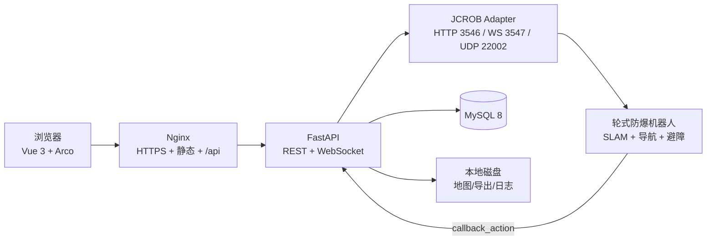

# 防爆机器人平台 — 方案定稿（一页纸）

> 2026-10-20 · 基于 JCROB 轮式防爆机器人 HTTP/WS 协议
>
> 平台设计：[平台方案-定稿.md](平台方案-定稿.md) · 能力依据：[PDF-SDK能力与平台方案.md](PDF-SDK能力与平台方案.md) · 接口溯源：[PDF接口原文索引.md](PDF接口原文索引.md)

## 1. 一句话结论

做一套 **Vue 3 + FastAPI + MySQL** 的单机器人巡检平台：机器人负责定位、导航、避障，平台负责状态可视化、任务编排、告警推导和审计；先只读接入，再开放任务下发，最后才碰遥控/IO/充电。

## 2. 架构

部署 3 个容器起步：`server`、`mysql`、`nginx`。本期不接视频/云台；不上 EMQX、TDengine、XXL-Job、ELK、Redis、MinIO、MediaMTX。

## 3. 技术选型

| 层 | 选择 | 理由 |
|---|---|---|
| 前端 | Vue 3 + TS + Vite + Arco Design Vue + Pinia | 控制台组件成熟，深蓝主题好统一 |
| 地图 | Canvas 自绘 + PNG 底图 | 只有一张室内栅格图，不需要 Leaflet 的瓦片/投影 |
| 图表 | ECharts | 环境曲线、告警统计 |
| 后端 | FastAPI + SQLAlchemy + Alembic + 进程内 asyncio 任务 | I/O 密集、单人开发快、自带 OpenAPI；需要 cron 时再加 APScheduler |
| 实时 | 原生 WebSocket | 平台→浏览器推送；机器人→平台由 Adapter 维护 |
| 数据库 | MySQL 8 | 任务/告警/审计/采样，一张库够用 |
| 部署 | Docker Compose + Nginx | 单机交付 |

**切换条件**：客户强制 Java 技术栈或交付后必须由 Java 团队维护 → 换 Spring Boot 3.2，前端/契约/表结构不变。

## 4. 真机必须拿到的数据

| 优先级 | 数据 | 接口/来源 | 用途 |
|---|---|---|---|
| P0 | 固件/导航类型/能力 | `/system/info`（`info.version`、`slam_type`） | 能力探测，不按型号写死 |
| P0 | 状态与定位状态 | `/system/status`、`/system/galileo_status` | 判断能否下发任务 |
| P0 | 地图元数据 + PNG | `/navigation/saved_maps`、`/navigation/map_png` | 坐标换算、底图 |
| P0 | 位姿 | `/navigation/pose`、`/map/pose` | 地图上的机器人位置/朝向 |
| P0 | 循环巡航结构 | `/navigation/loop_task` | 固定路线 |
| P0 | 任务/动作语义 | `/task`、`/action` | 到点拍照、等待、回充 |
| P0 | 完整错误码 | 各写接口 | 失败提示与重试 |
| P0 | 软件急停/通信超时停车 | 问厂家 | 决定“停止”是不是安全急停 |
| P1 | WS 样本 | `/galileo/status`、两个环境 topic | 实时曲线、断线策略 |
| 后续 | 视频/云台/测温 | `/system/onvif_camera/*` | 本期不做，等明确型号 |
| P1 | 续航/充电 | 实测 | 任务排期与低电策略 |

现场按 `真机联调数据采集表.xlsx` 填，重点不是“接口能不能通”，而是 **字段单位、枚举、失败表现、并发规则**。

## 5. 巡航与定位

- **不需要额外定位模块**。JCROB 自带视觉/雷达 SLAM，`slam_type` 为 `camera` 或 `lidar`；`odom`、`imu` 也在 `/system/info` 里。
- 巡航两种方式：固定路线用 `/navigation/loop_task`；到点拍照/IO/语音用 `/task` + `/action`（拍照走机器人自带相机，不依赖海康云台）。
- 视觉导航不传 `start_index` 会进入自动定位；雷达导航需要初始位姿，`-1` 表示充电桩位姿。
- 平台不做 SLAM，只做三件事：坐标换算、单位归一化、定位健康判定。
- **定位失败必须锁任务**：`navStatus`/`visualStatus`/`mapStatus` 异常、位姿长时间不更新、相邻帧跳变过大 → 禁止下发并提示人工介入。

## 6. UI

照片只作布局、配色、按钮样式的视觉参考，组件全部重做；功能与信息架构按 SDK 能力设计 6 页：驾驶舱、地图与点位、任务与巡航、告警中心、数据查询、系统设置。

驾驶舱三列：左状态/任务，中地图，右环境/告警；地图用 Canvas + PNG 底图，机器人箭头用 `theta_rad`，数据超过 3s 未更新就变灰并标“数据过期”。

## 7. 范围

**做**：单机器人、单地图、一条固定路线、任务下发/暂停/继续/停止、环境告警、历史查询、基础 RBAC。

**本期不做**：视频、云台、测温（后续单独接）。

**PDF 没有、本期不做**：15 串 BMS 单体电压、结构化告警接口、AI 表计/缺陷识别、MQTT/GB28181、软件急停、多机器人调度、7×24 录像。

**外部接入**：如果客户坚持要 BMS/固定设备/AI，它们是独立集成，不属于这套 SDK；平台先按 `docs/外部接口占位规范.md` 返回 `EXTERNAL_UNAVAILABLE`。

## 8. 六周节奏

| 周 | 目标 |
|---|---|
| 1 | 骨架、登录、数据库、探针夹具、UI 外壳 |
| 2 | 只读驾驶舱（状态/位姿/环境/告警） |
| 3 | 点位/路线/任务 CRUD、坐标换算 |
| 4 | 任务下发与状态机、暂停/继续/停止、callback |
| 5 | 历史/导出、告警中心、Docker 部署 |
| 6 | 真机联调、异常处理、验收缓冲 |

最大风险不是写不完页面，而是真机接口语义和现场网络。第 1 周拿不到真机数据，就要把“任务下发”降级为演示模式，并提前说明。

## 9. 需要你拍板

已定（2026-10-20）：交付日 **2026-12-01**；Docker Compose 部署到 192.168.8.40；纯内网；平台独立账号；阈值留空、前端可改；免责文案写进 UI。
14 条联调口径与详细修订见 [平台方案-定稿.md](平台方案-定稿.md) 头部；本页是摘要，冲突时以主方案为准。

仍待确认：

1. 机器人接哪个网段、具体 IP（真机 2026-11-10 可直连，已确认）？
2. 机器人能否反向访问平台（`callback_action` 需要一个可达 URL）？
3. 现场 `lel`/`smoke`/`temperature` 的报警阈值由谁给？
