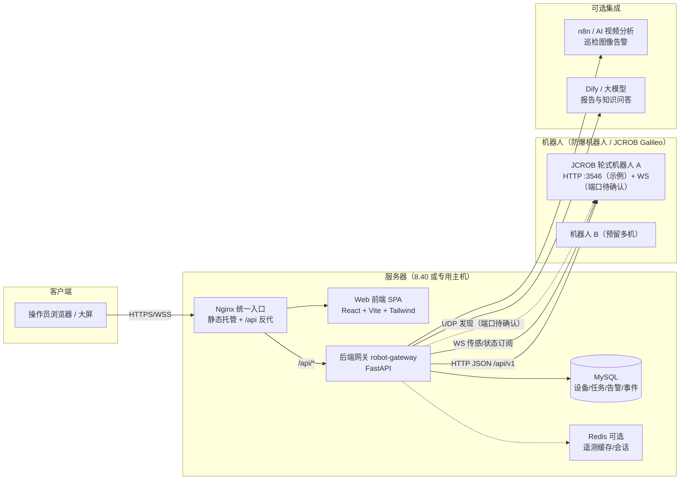

# 防爆机器人可视化平台 — 项目方案（架构与技术选型）

> 版本：v1.1 · 日期：2026-10-20 · 状态：**待评审**
>
> **接入对象（已确认）**：基于 JCROB 视觉导航 HTTP 协议的**轮式防爆机器人**。绝影 X30 机器狗及其 8890/ROS 体系不在本期接入范围，仅作为历史项目与可选 AI 告警链路参考。
>
> 方案输入：JCROB 视觉导航系统 HTTP 协议说明（PDF，109 页）、本地 `D:\Desktop\demo` 源码（jicheng / machine-dog / platform-mcp / RAG）、GitHub 开源项目调研。
> 本方案按 Ponytail（lazy senior dev）原则编制：**先给最小可交付，能复用绝不重写，不引入用不上的重型平台**。

---

## 一、结论先行

接口文档已经能支撑做一个**“单/多台防爆机器人全功能 Web 控制台 + 轻量中台”**，不需要从零发明，也不需要整套搬开源平台：

- **前端**：仿照本地已有 `jicheng`（React 19 + Vite + Tailwind + react-bits + Nginx/Docker），把它的“门户聚合/跳转”形态改造成“深度操作台”形态。
- **后端**：新增一个**薄网关（建议 FastAPI）**，负责机器人 HTTP(3546)/WebSocket、token 托管、多机注册、遥测缓存、任务与告警持久化；浏览器永远不直连机器人。
- **开源参考**：借鉴 openTCS 的“任务指令层/车辆适配器”分层、ThingsBoard/JetLinks 的“设备-遥测-告警-面板”思路、DataV/GoView 的大屏视觉思想；**明确不整套引入**任何重型平台（YAGNI）。
- **MVP 建议**：先做“机器人列表与健康状态 + 地图位姿叠加 + 基础遥控 + 任务下发”，再叠加任务编排、行为树、媒体云台、告警事件等 P1 功能。

---

## 二、输入与约束

| 项 | 内容 | 对方案的影响 |
|---|---|---|
| 接口文档 | 《JCROB 视觉导航系统 HTTP 协议说明》（109 页，C#/Python/Java 调用示例） | 能力来源；文档经 OCR 识别，个别字符有噪声，**接口路径细节以厂家原版文档和实测为准** |
| 服务器 | `http://192.168.8.40:8890/`（用户正在上传文件） | **本方案未访问、未调用该地址**；实际部署形态/机器人固件版本待上传完成后确认 |
| 本地源码 | `D:\Desktop\demo\jicheng`（React 门户）、`machine-dog`（n8n+MySQL+AI 告警）、`platform-mcp`（平台注册表/MCP/凭据脱敏）、`RAG`（巡检平台文档） | 前端工程结构、部署方式、告警链路、注册表模式均可复用 |
| 业务目标 | 防爆机器人可视化平台 | 不是“机器狗平台”照搬，也不是纯巡检大屏；是**对一台/少量 JCROB/Galileo 机器人做可视化、可下发指令、可监控告警**的操作平台 |
| 接入对象 | JCROB 协议轮式防爆机器人 | 平台按本文档的 HTTP/WS 能力设计；**不以 X30 机器狗的 ROS/UDP/TCP 协议为准** |

---

## 三、这份 PDF 能支撑什么功能（能力盘点）

PDF 覆盖了机器人从“建图 → 导航 → 任务执行 → 状态监控 → 媒体取证 → 语音/IO 联动”的完整链路，全部能接到平台上。按能力大类整理如下。

### 3.1 功能清单

| # | 能力模块 | PDF 中的代表性能力 | 平台能做的功能 |
|---|---|---|---|
| 1 | 系统状态与健康 | `/system/status`（Mapping/Navigating/Busy/Free）、`/system/info`（电量、急停、camera/odom/imu 话题频率、充电/循环标志）、`/system/galileo_status`（导航/视觉/建图/闭环/充电/目标点等细粒度状态）、日志 | 总览大屏、机器人健康看板、运行状态机、异常检测（急停/话题掉线/低电量） |
| 2 | 遥控与运动 | `/system/speed` GET/PUT（速度/角速度，文档建议约 5Hz 调用）、局部运动、导航/局部运动/IO 组合任务、校准（IMU/相机/雷达）、关机 | 遥杆/键盘/触屏遥控面板、局部运动按钮、防爆环境下的**互斥与二次确认** |
| 3 | 建图 | 建图启停/更新/保存、建图过程 png、运动轨迹、地图下载/上传 | 地图管理页（列表、预览、上传下发、删除） |
| 4 | 地图与导航 | 地图 png/pgm、路径点/目标点 CRUD、跨地图/跨楼层连接点、当前地图与位姿、导航启停、调度导航、自动充电/充电桩、精确对接、虚拟墙/忽略区域、地图二维码 landmarks、覆盖路径生成（巡检/清扫全覆盖） | **地图工作台**：地图底图 + 实时位姿叠加 + 目标点/路径可视化与编辑 + 虚拟墙管理 + 充电/对接命令 |
| 5 | 任务与动作编排 | Task 增删改查/启动/暂停/继续/取消/循环；Action 类型（导航、局部运动、IO、语音、回调、等待、blockly 自动化动作、云台拍照等）；任务状态 WAITING/WORKING/PAUSED/CANCELLED/ERROR/COMPLETE | 任务编排页（向导式组合子任务/动作）、任务执行面板（进度、状态、循环）、历史任务 |
| 6 | 行为树与自动化 | 行为树控制节点（sequence/parallel/fallback/loop 等，具体列表以原版文档为准）、黑板参数 `{}`、`/blocklytask` 自动化任务（图形化 blockly xml） | 自动化任务管理（列表、启停、xml 预览）、行为树可视化（P1/P2） |
| 7 | 媒体与云台 | 拍照/录像及文件管理、ONVIF 摄像头发现、RTSP 流地址、云台移动/预置点/测温、滑台/顶升机构 | 视频与云台页（快照、录像列表、云台控制、测温可视化）、红外/可见光联动 |
| 8 | 语音/迎宾/IO | TTS 播放/语音包管理/迎宾模式、语音模块电平/PWM/舵机、IO 电平与扩展板 | 语音播报管理、迎宾开关、继电器/声光/附属机构联动（如防爆声光报警） |
| 9 | 配置与运维 | config 读写/恢复默认、WiFi、音量、系统更新（预览版/自动更新日志）、证书、自检、系统日志 | 远程配置页、运维中心（自检/日志/更新/证书） |
| 10 | 文件系统 | 文件/文件夹 CRUD、详情、复制/剪切/批量删除 | 机器人文件管理器（地图、日志、媒体导出归档） |
| 11 | 环境传感（WS） | WebSocket：GalileoStatus、温湿度、可燃气体、光照度、空气传感器 | **防爆场景最相关的告警**：可燃气体浓度曲线与阈值告警、温湿度环境卡 |
| 12 | 机器人发现与安全 | UDP 局域网广播发现（机器人 ID/端口/MAC/版本，端口待确认）、HTTP 服务示例端口 3546、token 验证（配置项 `no_token_check`，默认行为待真机确认） | 多机自动发现/手动注册、平台侧统一认证与 token 托管 |

### 3.2 平台能力一句话概括

> 一台机器人：**看得见**（状态/地图/位姿/视频/传感）、**叫得动**（遥控/导航/任务/IO/语音）、**管得清**（配置/日志/文件/告警/运维）。

### 3.3 定位与巡航：文档能证明什么、不能证明什么

这一节专门区分**文档事实**、**平台侧推断**和**必须在真机确认的内容**，避免把“接口文档里写了”误当成“这台轮式机器人一定能用”。

| 问题 | 文档事实 | 判断/边界 |
|---|---|---|
| 机器人怎么知道自己在哪 | 文档开篇说明这是“融合多种传感器、以视觉导航为主导的定位和运动控制系统”；流程是建图 + 导航；`/map/pose` 返回当前位姿，GalileoStatus 返回 `currentPosX/Y/theta` | 定位在**机器人本体**完成，平台只读取位姿；平台不应自行做定位计算 |
| 有定位模块吗 | 文档提到视觉导航、雷达导航两种模式：雷达导航启动时必须给起始点，视觉导航可自动定位；支持 `/navigation/init_pose` 设置初始位姿、`/navigation/landmarks` 获取地图二维码、充电桩位置可作为初始位置；`/system/info` 暴露 camera/odom/imu 话题频率 | **“有定位能力”是事实**；但文档没有给出传感器型号、融合算法、定位精度、丢失后的恢复策略，这些必须看实机配置 |
| 有“巡航”功能吗 | PDF 没有把“巡航”定义为独立接口或成品功能，也没有 `/patrol` 这类端点；它提供的是导航点/路径、Task/Action、任务循环、`/navigation/coverage_path` 覆盖路径、自动巡检状态、自动充电 | **巡航是平台侧组合能力，不是机器人现成功能**；实现方式见 8.3 |
| 需要连接机器狗吗 | 与 X30 机器狗无关 | 需要连接的是**这台 JCROB 轮式机器人**的 HTTP 服务（示例端口 3546）和网络；不需要连 X30 的 ROS/8890 体系 |

**关键前提**：PDF 是“协议能力上界”，不等于你这台机器人已实现全部接口。不同型号/固件可能裁剪 Task、Action、ONVIF、覆盖路径等模块。开工前必须做一次只读能力探测（见第十三节）。

---

## 四、本地 demo 源码：哪些可以直接复用

### 4.1 复用结论（Ponytail 优先“已经存在的东西”）

| 资产 | 现状 | 复用方式 |
|---|---|---|
| `jicheng` 前端工程 | React 19 + Vite + Tailwind + react-bits；深色科技风；Sidebar + Header + 多视图；`useRealtimeData` 3s 轮询 hook；Nginx + Docker 部署；docs/superpowers 设计文档模板 | **前端骨架直接抄**：构建配置、主题、通用组件（StatTile/StatusBadge/EventLog）、Nginx 路由模式、Dockerfile/compose 模式 |
| `machine-dog`（不在本期范围） | n8n 工作流：机器狗拍照 → AI 盒子分析 → MySQL → 报告/推送 | 仅复用其**图像 AI 告警链路模式**（P2 可选）；不要复用其 8890/ROS 控制部分，那是 X30 的体系，与 JCROB 协议不兼容 |
| `platform-mcp` | `platforms.json` 平台注册表 + 凭据脱敏 + 已注册 Codex MCP | **模式复用**：机器人也应做成“平台注册表”，凭据明文不入 Git（`.gitignore`） |
| `RAG/…需求文档` | 工业巡检机器人平台需求/架构/可行性文档 | 参考领域模型与巡检场景术语；**不要整篇套用**（本项目是防爆机器人，不是巡检/机器狗综合体） |
| `docs/superpowers/*-design.md` | 现成的“目标/布局/交互/视觉/技术/文件/数据流/验收”文档结构 | 本方案即按该结构编写 |

### 4.2 与 jicheng 的本质差异（决定架构不能一刀切）

jicheng 是**“多平台聚合门户”**：主要做统计展示 + 新标签页跳转，数据以静态 JSON/单向轮询为主。

防爆机器人平台是**“深度操作控制台”**：

- 不只是展示，还要**下发指令**（遥控、导航、任务、IO、语音），必须处理指令互斥与安全确认；
- 有**强交互可视化**（地图 + 实时位姿 + 路径编辑），不是图表卡片；
- 有**长连接**（机器人 WebSocket 传感、状态推送），纯 3s 轮询不够；
- 涉及**多台机器人**时要有“设备注册 → 指令路由 → 遥测汇聚”的薄中台概念。

所以：**复用 jicheng 的壳（工程/视觉/部署），新增 robot adapter 与后端网关，这是本方案架构的核心判断。**

---

## 五、GitHub 开源项目调研结论

检索结论先说：**没有找到“开箱即用的防爆机器人网页平台”**。因此路线是“参考成熟平台的分层与可视化思路，搭一个薄而完整的自有平台”。

| 开源项目 | 定位 | 借鉴点 | 是否引入 |
|---|---|---|---|
| [openTCS](https://github.com/opentcs/opentcs) | 多 AGV 车队调度（Java），VDA5050 适配 | “调度/任务层 + 车辆驱动适配器（CommAdapter）+ Web 可视化”分层；任务(Task)与车辆指令分离 | 不整套引入（太重）；**借鉴分层概念**，把 JCROB 的 Task/Action 映射为平台任务模型 |
| [ThingsBoard](https://github.com/thingsboard/thingsboard) | IoT 设备接入/遥测/告警/Dashboard（Java） | 设备-遥测-告警模型；设备详情页组织方式 | 不引入（部署重、二次开发成本高）；**借鉴页面/数据组织思路** |
| [JetLinks](https://github.com/jetlinks/jetlinks-community) | 中文 IoT 基础平台（Spring Boot/WebFlux/Netty） | HTTP/TCP/UDP/MQTT 协议接入层、规则引擎、设备管理 | 不引入；若未来要管理几十台异构设备再评估，**MVP 用薄 adapter 足够** |
| [GoView](https://github.com/dromara/go-view) | Vue3 大屏可视化低代码平台 | 大屏组件/拖拽布局思想 | 只做“大屏模式”参考；平台核心仍是操作台而非展示大屏 |
| [DataV](https://github.com/DataV-Team/DataV) | 可视化组件库（边框/图表/轮播） | 视觉模板参考（科技风边框、指标卡） | 不引入（Vue 系组件与 React 工程不匹配，仅借鉴设计语言） |
| Open-RMF / Foxglove / RobotWebTools(rosbridge/roslibjs) | 机器人任务编排 / Web 可视化 / ROS Web | 位姿叠加、时间序列面板、任务面板的交互范式 | 仅作交互参考；JCROB 是 HTTP/WS 私有协议，不引入 ROS 栈 |

**YAGNI 判断（Ponytail 阶梯第 1 级）**：用户目标是对少数 JCROB/Galileo 机器人做可视化控制，不是建车队调度中心。开源的 ThingsBoard/openTCS/JetLinks 都是“为大量异构设备、多租户、可扩展”设计的重型平台，整套引入等于替未来不存在的需求付今天的复杂度。

---

## 六、总体架构

### 6.1 逻辑架构



### 6.2 分层职责

| 层 | 组件 | 职责 | 关键点 |
|---|---|---|---|
| 接入层 | robot adapter（每台机器人一个适配实例） | 封装 JCROB HTTP(3546)/WS，token 注入、超时重试、UDP 发现 | **唯一的机器人协议接触点**；换固件版本只改这里 |
| 领域服务层 | 设备注册、遥测、任务、媒体、告警、配置审计 | 轮询/订阅状态 → 落库/缓存；任务下发与状态跟踪；告警判定 | 防爆重点：可燃气体阈值告警、低电量、急停、话题掉线 |
| API 层 | FastAPI REST + WS | 对前端提供 `REST /api/robots/{id}/...` + `WS /ws/robots/{id}` | 前端不直连机器人；OpenAPI 自动文档 |
| 前端 | React SPA | 页面与交互：地图、遥控、任务、监控 | 沿用 jicheng 工程模板 |
| 部署层 | Nginx + Docker Compose | 静态托管、`/api` 反代、多项目路由共存 | 沿用 jicheng 已验证的部署模式 |

### 6.3 数据流（两条主线）

**监控线（低频状态）**

```text
机器人 HTTP /api/v1/system/info + /system/galileo_status
   → robot-gateway 定时拉取（1–3s，可配置）
   → 内存缓存 + MySQL 写入状态/遥测快照
   → 前端 useRealtimeData 轮询 /api/robots/{id}/status
```

**实时线（高频传感/状态）**

```text
机器人 WebSocket（GalileoStatus/温湿度/可燃气体/光照/空气）
   → robot-gateway WS 客户端订阅
   → 前端 WS /ws/robots/{id}/telemetry 推送
   → 图表实时曲线 + 阈值告警
```

**指令线（写操作）**

```text
前端（遥控 5Hz / 任务 / IO / 语音）
   → robot-gateway 校验（互斥状态、二次确认、审计日志）
   → 机器人 HTTP / 对应 API
   → 结果回传前端
```

---

## 七、技术选型

### 7.1 前端

| 维度 | 选型 | 理由 | 风险/备注 |
|---|---|---|---|
| 框架 | React 19 + Vite | jicheng 已验证；react-bits 是 React 组件 | 不引 Vue，避免团队两套栈 |
| 样式 | Tailwind CSS + CSS 变量主题 | 深色科技风、深浅模式可复制 jicheng | 沿用现有主题变量体系 |
| 路由 | react-router（新增） | 本项目页面/路由多于门户，需要 URL 化 | jicheng 用 useState 切换，本项目建议正式路由 |
| 状态/请求 | 轻量 fetch 封装 + 自定义 hook | 复用 jicheng `useRealtimeData` 思路 | MVP 不引 Redux/Zustand |
| 图表 | ECharts | 传感曲线、告警趋势、健康雷达 | 内网部署注意打包体积 |
| 地图渲染 | Canvas 2D 自绘（地图 png + 位姿/路径/目标点） | 地图是像素图 + 自定义坐标，canvas 最直接 | **坐标系标定**：地图 png 像素 ↔ 机器人 map 坐标系需实测；P2 再考虑 Leaflet/MapLibre |
| 视频流 | P2：MediaMTX/ffmpeg 转流或 jessibuca | RTSP 无法被浏览器直接播放 | MVP 先做快照/录像文件，直播放 P2 |
| 图标/动画 | Lucide + react-bits（CountUp/SpotlightCard 等） | 视觉延续 jicheng | 按需复制组件，不整包带 node_modules |

### 7.2 后端

| 维度 | 选型 | 理由 | 风险/备注 |
|---|---|---|---|
| 语言/框架 | Python 3.10+ / FastAPI | 与 machine-dog、jicheng 统计脚本同一技术族；async httpx + WebSocket 天然匹配；自动 OpenAPI | 团队已有 Python 脚本经验 |
| HTTP 客户端 | httpx（async） | 机器人 HTTP 大量并发轮询/指令 | 请求机器人路径统一走 adapter |
| 实时 | FastAPI WebSocket + 内部 pub/sub | 转发机器人 WS 传感与状态 | 单机场景内存 pub/sub 够用 |
| 数据库 | MySQL（服务器已有实例，具体库表待确认） | 设备/任务/告警/审计落库 | 表结构轻量，约 8–10 张表 |
| 缓存 | Redis（P1 可选） | 多机高频遥测缓存 | MVP 可不引（单机内存 dict 足够） |
| 任务调度 | APScheduler / asyncio task | 轮询采集、定时巡检任务 | 与 n8n 职责边界：n8n 管外部 AI/推送工作流，网关管机器人控制 |

### 7.3 部署

| 项 | 方案 | 说明 |
|---|---|---|
| 开发 | Vite dev server 代理 `/api` → FastAPI localhost:8000 | 避免 CORS 问题 |
| 生产 | 单容器 Nginx（静态 + 反代）/ FastAPI 容器 / MySQL 已有 | 沿用 jicheng：`nginx.conf` + `docker-compose.yml` + host 网络 |
| 统一入口 | 复用服务器 8.40 Nginx 或独立端口 | **待用户上传完成后再确定**（现在不访问 8.40） |

---

## 八、功能模块 → 页面映射（仿照 jicheng 布局）

### 8.1 页面骨架

```text
┌──────────────────────────────────────────────────────────────┐
│ 防爆机器人可视化平台          机器人在线:1   ⏰ 14:30:08  主题 │
├────────┬─────────────────────────────────────────────────────┤
│ 总览    │  [在线 1] [电量 78%] [可燃气体 正常] [任务 运行中]    │
│ 机器人工 │  ┌─ 机器人卡片 ─────────┐ ┌─ 告警/事件时间线 ────┐  │
│ · 状态  │  │ 状态机/位姿/传感卡     │ │ 最近事件           │  │
│ · 地图  │  └─────────────────────┘ └────────────────────┘  │
│ · 遥控  │  ┌─ 环境传感曲线（WS）──────────────┐              │
│ · 任务  │  │ 可燃气体/温湿度/光照/空气          │              │
│ 地图管理│  └──────────────────────────────────┘              │
│ 媒体云台│                                                     │
│ 告警事件│                                                     │
│ 运维中心│                                                     │
│ 大屏(选)│                                                     │
└────────┴─────────────────────────────────────────────────────┘
```

### 8.2 页面明细

| 页面 | 数据来源 | 核心交互 | 对应 PDF 模块 |
|---|---|---|---|
| 总览 Dashboard | 多机状态汇总 | 机器人在线卡、KPI、告警时间线、快捷操作 | 系统状态/发现/传感 |
| 机器人工位-状态 | `/system/info`、`/system/galileo_status`、日志 | 健康指标、状态机、子模块（视觉/建图/闭环/充电）、急停 | 状态/自检 |
| 机器人工位-地图 | 地图 png/pgm、路径/目标点/虚拟墙 API、位姿 WS | 底图叠加位姿、点选目标点下发、圈画虚拟墙、覆盖路径预览 | 导航全套 |
| 机器人工位-遥控 | `/system/speed`、局部移动/对接 API | 键盘/手柄遥控（5Hz）、安全互锁与二次确认、紧急停车 | 遥控/局部运动/精确对接 |
| 机器人工位-任务 | `/task`、`/action`、行为树 API | 任务列表/创建向导（导航→IO→语音→等待组合）、启停暂停循环、进度条 | Task/Action/行为树 |
| 巡航方案 | 平台侧 PatrolRoute/PatrolPoint + `/task`、`/action` | 选点成线、每点动作、循环/定时、执行监控、异常暂停与人工接管 | Task/Action/loop、导航点/路径、coverage_path |
| 自动化任务 | `/blocklytask` | 自动化任务列表与启停；XML 只读可视化 | blockly 自动化 |
| 地图管理 | 建图/地图文件 API | 地图列表、上传下载、删除、轨迹回放 | 建图 |
| 媒体与云台 | 拍照/录像/ONVIF/RTSP | 快照、录像列表、云台方向/预置点、测温读数、滑台/顶升 | 媒体/云台/机构 |
| 语音与 IO | 语音包/TTS/迎宾、IO 电平 API | 语音试听与下发、迎宾开关、继电器/声光联动 | 语音/IO |
| 配置与运维 | config/WiFi/音量/更新/证书/自检 API | 参数读写（带确认）、日志 tail、文件管理器 | 配置/运维/文件 |
| 告警与事件 | WS 传感 + MySQL 事件 + AI 盒子(可选) | 可燃气体/温湿度阈值告警、事件回放、n8n 告警汇聚 | 环境传感 WS/AI 集成 |
| 大屏（P2 可选） | 汇总数据 | 多机态势、巡检覆盖率、环境热区 | 大屏展示扩展 |

### 8.3 巡航方案：平台侧要自己补的一层

**事实**：PDF 没有把“巡航”定义为独立接口或成品功能，也没有现成的 `/patrol` 端点；它提供的是导航点/路径、Task/Action、任务循环、覆盖路径、充电/充电桩、二维码地标和自动巡检状态。**因此巡航是平台侧的组合能力，不应写成机器人现成功能。**

平台侧新增 `PatrolRoute` 概念，把“路线”编译成机器人 Task，而不是要求机器人新增协议：

```text
巡航方案 = 有序巡检点 + 每点动作 + 循环/定时策略 + 异常处理

选地图/标定点位 → 排序并配置每点动作 → 生成 PatrolRoute
   → 编译为 JCROB Task（导航 Action + IO/拍照/TTS/等待）
   → POST /task、/task/start
   → 轮询/WS 监控状态
   → 异常则暂停/取消并告警，人工接管
```

| 巡航要素 | 平台实现 | 依赖的 PDF 能力 | 边界/备注 |
|---|---|---|---|
| 路线 | 有顺序的 waypoint 列表（map + x/y/theta + 停留时间） | 导航点/路径、`/navigation/init_pose`、`/map/pose` | 点位需先在地图上标定；坐标系必须实测 |
| 每点动作 | 动作模板：拍照/热成像/IO/语音/等待/局部移动 | `/action` 各类 Action | 具体 action type 以实机支持为准 |
| 循环/定时 | Task `loop` + 平台调度器 | Task 循环 | **PDF 只有任务循环，没有日历/定时巡航**；定时是平台能力 |
| 全覆盖 | 生成覆盖路径作为任务子项 | `/navigation/coverage_path` | 适合区域巡检，不适合精细点位 |
| 回充 | 任务结束后导航到充电桩 | 充电/充电桩 API | 低电量策略由平台判定并二次确认 |
| 异常处理 | 暂停/取消/告警/人工接管 | `/task/pause|resume|stop`、急停状态 | **不得自动绕过机器人本体的安全逻辑** |

实现顺序建议：先做“顺序点位 + 每点拍照”的最小闭环；如果实机不支持 Task 组合，退化为网关按顺序调用单点导航/动作 API（可靠性更低，必须有状态机与超时）。

---

## 九、后端数据模型与接口设计

### 9.1 核心表（MySQL，MVP 级）

| 表 | 关键字段 | 说明 |
|---|---|---|
| robots | id、name、ip、http_port、mac、model、firmware、token_encrypted、enabled | 平台注册表（延续 platform-mcp 模式） |
| robot_status | robot_id、status、battery、estop、map、path、pos_x/y/theta、galileo_json、updated_at | 最新状态快照（覆盖写） |
| telemetry | robot_id、ts、temp、humidity、flammable_gas、illumination、pm | 传感时序（可 TTL 清理） |
| tasks | id、robot_id、task_json、status、progress、loop_flag、created_by、timeline | 机器人侧 Task 的本地镜像 + 审计 |
| actions | id、robot_id、action_json、type | Action 模板库（可复用组合） |
| alarms | id、robot_id、level、source、message、payload、ts、ack_by | 告警/事件统一出口 |
| audit_logs | id、actor、action、robot_id、params、result、ts | 所有写指令审计（防爆环境必要） |
| patrol_routes | id、robot_id、name、map_name、loop、schedule_cron、enabled | 巡航方案定义 |
| patrol_points | id、route_id、seq、x、y、theta、dwell_sec、actions_json | 点位顺序与每点动作 |
| patrol_runs | id、route_id、robot_id、task_id、status、started_at、ended_at | 巡航执行记录 |

### 9.2 网关 API 风格（示例）

前端统一走网关，URL 风格 `REST /api/v1/robots/{robot_id}/...`，内部再映射到机器人 `/api/v1/...`（PDF 中示例前缀为 `/api/v1`，具体以厂家原版文档为准）。

| 网关接口（示例） | 机器人侧目标 | 用途 |
|---|---|---|
| `GET /api/v1/robots` | UDP 发现表 + 注册表 | 多机列表/在线状态 |
| `GET /api/v1/robots/{id}/status` | `/system/status`、`/system/info` | 状态快照 |
| `GET /api/v1/robots/{id}/galileo` | `/system/galileo_status` | 细粒度状态 |
| `PUT /api/v1/robots/{id}/speed` | `/system/speed` | 遥控 |
| `GET/POST/PUT/DELETE /api/v1/robots/{id}/task` | `/task` | 任务 CRUD |
| `GET /api/v1/robots/{id}/task/start` 等 | `/task/start|pause|resume|stop|loop` | 任务控制 |
| `GET/POST/PUT/DELETE /api/v1/robots/{id}/action` | `/action` | 动作 CRUD |
| `GET /api/v1/robots/{id}/maps`、`.../map/png` | 地图相关 API | 地图可视化与下载 |
| `GET/POST/PUT/DELETE /api/v1/robots/{id}/navigation/point|path|...` | 导航点/路径/虚拟墙等 | 地图编辑 |
| `GET /api/v1/robots/{id}/photo|video` | 拍照/录像/文件 API | 媒体取证 |
| `WS /ws/robots/{id}/telemetry` | 机器人 WS 订阅 | 实时传感推送 |
| `GET /api/v1/alarms`、`POST /api/v1/alarms/{id}/ack` | 本地事件流 + 机器人状态判定 | 告警中心 |

> 注：机器人侧存在固件版本差异（如遥控可走 WS 的版本、返回字段版本差异），adapter 层需做**版本兼容开关**；网关层不假设所有机器人同一版本。

### 9.3 安全与防爆环境操作纪律

- 平台登录鉴权 + 机器人 token 托管（机器人侧 `no_token_check=false` 时启用；凭据加密后存库，**不入 Git**）。
- 危险指令（关机、开始充电、精确对接、持续遥控、IO 带电操作）需要前端二次确认 + 后端互斥校验（如系统处于 Busy/Navigating 时禁止冲突遥控）。
- 写指令全部写 `audit_logs`，可追溯“谁在何时对哪台机器人做了什么”。
- 可燃气体等环境传感接告警规则，联动急停/巡检停止需要人工确认，不自动远程执行高危动作（防爆场景安全优先）。

---

## 十、工程组织与目录建议

**建议：新建独立仓库 `D:\Desktop\防爆机器人\explosion-proof-robot-console\`，只“复制模式”，不“整目录搬运”。**（避免把 jicheng 的 node_modules、凭据、platform-mcp 内部密码等历史杂质带入新工程。）

```text
explosion-proof-robot-console/
├── README.md
├── docs/
│   ├── 本方案.md
│   └── robot-api-map.md          # 逐接口适配映射表（对照厂家原版 PDF）
├── deploy/
│   ├── nginx.conf                # 抄 jicheng 模式：静态 + /api 反代
│   ├── Dockerfile
│   └── docker-compose.yml
├── backend/                      # FastAPI robot-gateway
│   ├── app/
│   │   ├── main.py
│   │   ├── config.py             # 从环境变量/配置文件读取，凭据不入 Git
│   │   ├── adapters/             # jcrob_adapter.py（唯一接触机器人协议的地方）
│   │   ├── services/             # telemetry/task/alarm/audit
│   │   ├── models/               # SQLAlchemy 表
│   │   └── api/                  # REST + WS 路由
│   └── tests/                    # 一个最小自检（Ponytail：留可运行检查）
├── frontend/                     # 从 jicheng 抽骨架改造
│   ├── src/
│   │   ├── components/           # 复刻通用组件（StatusBadge/StatTile/EventLog）
│   │   ├── hooks/useRealtimeData.js
│   │   ├── views/                # 8.2 页面明细
│   │   └── maps/                 # canvas 地图渲染
│   └── ...
└── scripts/
    └── discover_robots.py        # UDP 发现监听（端口待确认，可选守护进程）
```

---

## 十一、里程碑与验收标准（Ponytail：先最小可交付）

### P0 MVP（估算 1–2 周；前提是真机接口可用且能进场联调）

范围：工程骨架 + 机器人注册/发现（先手动 IP，UDP 发现加分）+ 健康状态看板 + 地图底图与实时位姿叠加 + 基础遥控 + 单任务下发。

验收标准：

- 浏览器打开平台能看到机器人列表，状态字段（电量/状态机/急停/话题频率）每 3s 刷新；
- 地图 png 能显示，机器人实时位姿以箭头形式叠加在底图上，刷新延迟 ≤ 1s；
- 遥控面板能发 `/system/speed`，松开即停；Busy 状态下前端禁用冲突指令；
- 能创建并启动一个“导航到目标点”任务，页面能看到状态流转；
- 写操作有审计日志；凭据不进 Git。

### P1（估算 3–4 周；不含厂家接口补齐与现场整改时间）

范围：任务编排页（组合子任务/动作）、**巡航方案页（路线编排 + 每点动作 + 循环/定时 + 执行监控）**、自动化任务管理、行为树只读可视化、媒体（拍照/录像/文件）、云台与测温、语音/IO/迎宾、环境传感 WS 实时曲线与阈值告警、告警事件落 MySQL、Nginx + Docker 部署到 8.40 统一入口。

验收标准：

- 能通过页面组合“导航 → IO 电平 → 拍照 → 语音播报”的巡检任务并执行；
- 能配置一条不少于 3 个点位的巡航路线，按序执行每点动作，支持循环、暂停/恢复/取消，执行记录可查询；
- 可燃气体/急停等异常能 2s 内在告警中心出现事件并可确认归档；
- 拍照可预览、录像文件可在平台下载；云台可方向移动与调预置点；
- 行为树/blockly 任务列表可查看与启停；
- 全站命令延时（内网）≤ 500ms 可感知，遥控 5Hz 无丢包感。

### P2（可选，不排期）

- RTSP 直播（MediaMTX/ffmpeg 转流或 jessibuca）；
- 巡检图像 AI 告警集成（复用 machine-dog n8n + AI 盒子链路）；
- 多机器人调度与自动充电编排（借鉴 openTCS 的 order/任务模型）；
- 大屏模式（参考 DataV/GoView 视觉）；
- 大模型助手（基于平台事件生成巡检报告，Dify 对接）。

---

## 十二、风险与待确认事项

| 风险/待确认 | 说明 | 应对 |
|---|---|---|
| **PDF 能力 ≠ 实机能力** | 文档描述的是 JCROB 导航系统的完整协议面；具体机器人可能裁剪 Task、Action、ONVIF、覆盖路径等模块，不能按文档全量承诺交付 | 先做只读能力探测与接口对照表，再排功能；缺失能力在方案中降级或删除 |
| 8.40 实际服务形态未知 | 8890 上的部署内容、与 JCROB 机器人的网络关系尚未确认 | **按约束暂不访问**；上传完成后只读探测并校准 |
| OCR 噪声 | PDF 经 OCR 识别，个别 URL/参数可能有误差 | 立项时逐接口对照厂家原版 PDF，产出 `robot-api-map.md` |
| WS/UDP 端口未核实 | OCR 能确认存在 WebSocket 与 UDP 发现机制，但具体端口未能可靠取证；旧稿中的 22002 不应作为既定事实 | 原版 PDF + 真机抓包确认；adapter 中配置化 |
| 固件版本差异 | 文档多次提到版本差异（如 WS 遥控、info 字段） | adapter 做版本分支，先在真机验证一组最小接口 |
| 地图坐标系标定 | png 像素 ↔ map 坐标（x/y/yaw）的换算需实测 | 用机器人当前位姿与地图上人工点做标定校准 |
| RTSP 跨浏览器 | 浏览器不能直接播 RTSP | MVP 用快照；P2 引入转流组件 |
| token 验证行为待确认 | 文档有 `no_token_check` 配置项，但默认值与生效范围需真机确认 | 平台侧统一托管 token 并开启验证，降低误连风险 |
| 单机 vs 多机 | 防爆机器人可能只有 1–2 台 | 架构按 `robot_id` 设计，MVP 按单机深做 |
| 危险指令误操作 | 防爆环境不可逆风险 | 二次确认 + 互斥校验 + 审计日志 |
| 网络与失联保护 | 无线漫游/丢包会让遥控和任务状态失真；平台不能替代机器人本体的失联停车 | 真机验证断网/弱网行为；平台只做监控与告警，安全停车由机器人保证 |
| 防爆合规与操作授权 | 软件可视化不改变整机防爆认证；远程 IO/充电/对接涉及现场 SOP | 高危动作二次确认并留审计；按现场规程执行，不把平台当安全联锁 |
| 厂家授权与固件支持 | HTTP 控制接口的开放范围、token 策略、保修责任需要厂家书面确认 | 取得接口清单/版本说明；保留只读降级模式，不依赖未授权接口 |

---

## 十三、建议的下一步动作

1. **只读能力探测**：依次验证 `GET /system/info`、`/system/status`、`/system/galileo_status`、`/map/pose`、`/navigation/landmarks`、`/task`、`/action`、`/system/onvifcameras`，记录实际前缀、端口、字段与固件版本；
2. **网络与安全确认**：服务器到机器人 HTTP 端口的连通性、token 配置、WS 端口；此阶段不测试运动指令；
3. **地图标定**：取 3 个已知点验证地图 png 像素 ↔ map 坐标（x/y/theta）的换算；
4. **最小巡航闭环**：在安全场地用“2 个点 + 拍照”验证 Task/Action 组合、循环以及暂停/恢复；确认后再扩到 P1；
5. 产出 `robot-api-map.md` 与 OpenAPI 契约，再按 P0 范围搭建前后端。

以上第 1–2 步只需要连接 **JCROB 轮式机器人**，不需要连接 X30 机器狗。

---

## 附：本方案依据与口径说明

- 机器人 API 前缀以 PDF 示例 `/api/v1/...` 为原型；HTTP 服务端口 3546 在 PDF 示例中出现。WebSocket 与 UDP 发现机制在文档中存在，但 **WS/UDP 的具体端口在 OCR 文本中未能可靠核实，旧稿中的 22002 不作为既定事实**；以原版 PDF 和真机抓包为准。
- 本方案未访问 `http://192.168.8.40:8890/`，其中“统一入口复用 8.40 Nginx”仅为可选部署建议。
- 开源项目结论基于 GitHub 检索与公开仓库信息（调研时间 2026-09-08，本次复核 2026-10-20），仅作为架构参考，不构成商务选型承诺。
