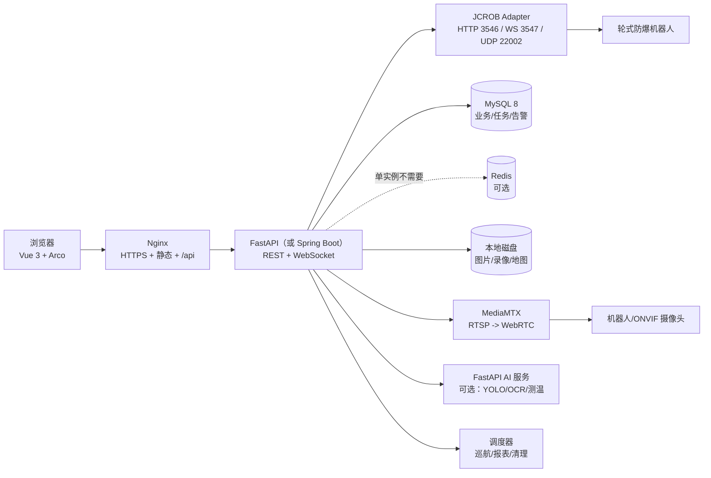

# 防爆机器人平台 — 实施方案 v3.0（评审定稿）

> 日期：2026-10-20 · 状态：定稿，待你确认第 12 节的三个决策
>
> 接入对象：**基于 JCROB 视觉导航 HTTP 协议的轮式防爆机器人**（不是绝影 X30 机器狗）。
>
> 输入依据：
> - `API接口导航2024_HTTP_20240619142112(1).pdf`（JCROB 导航系统 HTTP 协议说明，109 页；本次用 pdfplumber 提取原文核对字段）
> - `智能巡检机器人管理平台-技术规范.xlsx`（**非原厂资料，仅历史参考，不作为能力依据**）
> - `D:\Desktop\demo` 下 jicheng / machine-dog / platform-mcp 等历史项目（**非原厂资料，仅工程参考**）
> - `外部模型API接入.md`
>
> 约束：尚未访问 `http://192.168.8.40:8890/`；UI 参考照片在 `D:\Desktop\工作1\机器狗\导览系统效果图\`（没有 Figma）；单人开发，目标 12 月前交付；视频默认海康云台、可见光+热成像，不做 7×24 录像。
>
> 本版变化：豆包与 GLM 的实际评审已执行（记录见 `docs/model_review_20261020-140309.md`）。第 13 节写了两家共识、分歧和我的取舍；技术栈默认改为 **Vue 3 + FastAPI**，Spring Boot 作为合同硬指标时的切换路径。

> **2026-10-20 范围修订（以此为准）**：你确认唯一原厂资料是这份 PDF。本文第 4 节的 xlsx 模块矩阵、第 7 节的 UI 照片分析、第 10 节的成本估算只是历史工程参考，**不再作为机器人能力依据**。机器人能做什么、接口叫什么，以 [PDF-SDK能力与平台方案.md](docs/PDF-SDK能力与平台方案.md) 和 [PDF接口原文索引.md](docs/PDF接口原文索引.md) 为准。

---

## 0. 结论摘要

### 0.1 先定四件事

1. **先做只读数据接入，不先做遥控。** 真机第一轮只跑 `scripts/probe_jcrob.py`，拿到状态、位姿、地图、环境传感、任务/动作、媒体能力清单；确认字段与固件版本后，再开放写操作。
2. **xlsx 规范不能原样照搬。** 规范假设 MQTT、15 串 BMS、机器人主动告警、点位 AI 结果；JCROB 实际提供的是 HTTP + WebSocket，且没有结构化告警/单体电压/AI 结果接口。必须增加 **JCROB Adapter**，并把缺口显式列为外部依赖。
3. **默认选型是 Vue 3 + FastAPI。** 理由不是“Python 更好”，而是本项目 80% 的工作量在协议适配、状态同步、前端页面，不在企业 CRUD；单人 6 周写 Java 全家桶会挤掉真机联调时间。只有当 xlsx 是合同硬指标、或客户明确要求 Java 团队接手时，才切 Spring Boot 3.2 + RuoYi-Vue-Plus（只取 RBAC/菜单/日志）。两种方案的前端、数据契约、数据库表不变，**MVP 都不部署 EMQX / TDengine / XXL-Job / ELK**。
4. **交付范围按“一条路线、一台机器人、一路双光视频、任务可下发”定。** xlsx 里的空调、充电房设备、15 串 BMS、点位 AI 识别、人脸识别、双摇杆遥控，在 JCROB 协议下没有数据源或安全闭环，本期不做，只留占位接口和文档。

**关于“巡航 / 定位 / 是否必须连真机”的直接回答**：巡航由机器人自己执行（`/navigation/loop_task` 或用 `/task` + `/action` 编排），定位由 JCROB 的视觉/雷达 SLAM 完成，平台只消费位姿、下发任务、做坐标换算与健康判定。室内巡航不需要额外定位模块；但平台必须能访问机器人的 `3546` / `3547` 端口（或通过现场边缘网关），否则只能做模拟数据和 UI，拿不到真机状态。

### 0.2 已核实的关键事实（来自 PDF 原文）

| 项 | 事实 | 影响 |
|---|---|---|
| HTTP 端口 | 默认 `3546`，前缀 `/api/v1` | Adapter 按此配置，允许改端口 |
| WebSocket | 默认端口 `3547`，URL 形如 `ws://ip:3547/<topic>?token=...` | 高频位姿/环境数据走 WS |
| UDP 发现 | 端口 `22002`，广播 `{id, port, mac, version}` | 可做局域网机器人自动发现 |
| 认证 | `/token?username=&password=`；配置项 `no_token_check` 默认 `true`（默认不校验） | 平台侧必须托管 token 并建议开启校验 |
| 位姿单位 | `/map/pose`、`/navigation/pose` 的 `angle` 单位是**度**；`nav_action.theta` 单位是**弧度** | Adapter 必须统一单位，否则地图朝向会错 |
| 地图坐标 | `x_map = x_origin + x_pixel * res`；`y_map = y_origin + h * res - y_pixel * res` | 前端/后端共用同一套换算，不能各自猜 |
| 任务状态 | `WAITTING / WORKING / PAUSED / CANCELLED / ERROR / COMPLETE` | 平台状态机按此映射 |
| 环境传感 | WS topics：`/galileo/status`、`/bw_env_sensors/EnvSensorData`、`/bw_env_sensors/AirSensorData`；需定期发 `ping` | 每秒 ping，断线重连 |
| 型号/版本 | 型号不是开发前提；需要 SDK/协议版本、固件版本、`slam_type` 和能力探测结果 | 平台按能力降级，不按型号写死；缺能力就隐藏/置灰 |

---

## 1. 真机数据契约（先确认拿到什么）

### 1.1 第一轮只读探测范围

目标不是“把所有接口调一遍”，而是确认五件事：

1. 这台机器人的固件版本、导航类型（camera/lidar）、HTTP/WS 是否可用；
2. 位姿、地图、任务、环境传感这四类核心数据能否稳定拿到；
3. 字段名、单位、取值范围是否与 PDF 一致；
4. 哪些 xlsx 模块所需的数据在 JCROB 中**根本不存在**；
5. 网络延迟、断线表现和 token 行为。

### 1.2 P0 必须拿到的数据（缺一不可）

| 数据组 | 接口（GET） | 关键字段 | 用途 | 建议采样 | 存储 |
|---|---|---|---|---|---|
| 身份/版本 | `/system/info` | `battery`、`camera_rgb`、`camera_depth`、`odom`、`imu`、`driver_port`（硬件急停按钮，true=按下）、`charge`、`loop`、`info{version,code_name,id,mac,port}`、`slam_type` | 设备注册、健康判定、能力识别 | 3–5s | MySQL 快照 |
| 系统状态 | `/system/status` | `status`：`Mapping/Navigating/Busy/Free` | 控制互斥、状态机 | 1–3s | 进程内缓存 |
| 导航细状态 | `/system/galileo_status` | `navStatus`、`visualStatus`、`mapStatus`、`gcStatus`、`gbaStatus`、`chargeStatus`、`loopStatus`、`power`、`targetNumID`、`targetStatus`、`targetDistance`、`angleGoalStatus`、`controlSpeedX/Theta`、`currentSpeedX/Theta`、`currentPosX/Y/currentAngle`、`busyStatus` | 实时位姿、导航/视觉/充电/巡检状态、速度 | 1–5s（优先 WS） | 进程内缓存 + MySQL 快照 |
| 自检 | `/system/self_test` | `motor_driver`、`camera`、`charge`、`lidar`、`bluetooth`、`battery` | 设备健康、告警 | 30–60s | MySQL/告警 |
| 地图元数据 | `/navigation/saved_maps` | `resolution`、`origin`、`name`、`md5sum`、`map_type`、`levels`、`slam_type` | 地图列表、坐标换算 | 启动/变更时 | MySQL |
| 当前地图 | `/navigation/current_map` | `name`、`md5sum` | 判断地图是否切换 | 5–10s | 进程内缓存 |
| 地图图片 | `/navigation/map_png?name=` | PNG 二进制 | 地图底图 | 按需/变更时 | 本地磁盘 |
| 位姿 | `/navigation/pose` 或 `/map/pose` | `x`、`y`、`angle`（度） | 地图叠加、任务进度 | 1s 或 WS | 进程内缓存 |
| 环境传感 | WS `/bw_env_sensors/EnvSensorData` | `temperature`、`rh`、`smoke`、`pm1_0`、`pm2_5`、`pm10`、`lel`、`noise` | 防爆环境告警、曲线 | WS 推送 | MySQL/时序 |
| 空气传感 | WS `/bw_env_sensors/AirSensorData` | `temperature`、`rh`、`co2`、`illuminance` | 环境看板 | WS 推送 | MySQL/时序 |
| 任务 | `/task`、`/task?id=` | `id`、`name`、`loop_flag`、`state`、`sub_tasks`、`progress`、`current_task` | 任务列表、执行进度 | 运行中 1s；空闲 5–10s | MySQL |
| 媒体能力 | `/system/onvif_cameras`、`/system/onvif_camera/stream` | `ip`、`port`、`stream`（RTSP URL） | 视频通道发现 | 启动/变更时 | MySQL |

### 1.3 P1 建议拿到的数据

| 数据组 | 接口 | 关键字段/说明 |
|---|---|---|
| 导航路径 | `/navigation/path?map_name=&path_name=` | `path_data`：每行 `x y z` |
| 导航点 | `/navigation/nav_points?map_name=&path_name=` | `path_data`：`x y z theta errorX errorY direction name` |
| 巡航任务 | `/navigation/loop_task`（GET 读状态；POST/DELETE 启停） | 循环任务对象/状态；POST 参数 `wait_time` |
| 导航任务控制 | `/navigation/start`、`/navigation/start_nav_task`、`/navigation/stop_nav_task`、`/navigation/move to index`（PDF 原文含空格） | `map`、`path`、`start_index`、`level`；注意 PDF 中部分启动接口是 GET，但属于写操作 |
| 充电 | `/navigation/go_charge`、`/navigation/stop_charge`、`/navigation/charge_pose` | 充电任务对象、充电桩位姿（x/y/angle） |
| 连接点 | `/navigation/point_connections` | `points`、`connections`（跨地图/楼层） |
| 虚拟墙/忽略区 | `/navigation/virtual_wall`、`/navigation/skip_area` | 字符串坐标，按行解析 |
| 二维码地标 | `/navigation/landmarks?map_name=` | `map_name`、`landmarks` |
| 轨迹 | `/navigation/robot_tracks?map_name=` | `trajectory` / `track` |
| 当前路径 | `/navigation/current_path` | `map`、`path` |
| 目标距离 | `/navigation/target_distance` | `distance` |
| 风向 | `/navigation/wind_info` | `current_speed`、`max_speed`、`level`、`direction` |
| 云台位姿 | `/system/onvif_camera/pose` | `x`、`y`、`zoom` |
| 热成像测温 | `/system/onvif_camera/temperature` | 测温规则、最高/最低/平均温度、坐标 |
| 拍照/录像列表 | `/system/saved_images`、`/system/saved_videos` | 文件列表 |
| 配置 | `/system/config` | `default_map`、`maps`、`auto_charge`、`slam_type`、速度/PID 参数 |
| IO | `/system/io`、`/system/bw_io` | `out1..3`；扩展板 `in/out 0..7` |
| 语音 | `/system/tts/playing`、`/system/tts/records`、`/system/volume` | 播放状态、记录、音量 |
| 网络/证书 | `/system/wifi`、`/system/is_online`、`/system/check_cert` | 网络状态、证书 |
| 自动化任务 | `/blockly_task` | `title`、`description`、`is_enabled`、`blocklyxml` |

### 1.4 WebSocket 数据契约

| Topic | 字段 | 单位/说明 | 用途 |
|---|---|---|---|
| `/galileo/status` | PDF 只说明返回 JSON，未给完整 schema；按 `/system/galileo_status` 同构假设，需实机采样确认 | 位姿 `currentAngle` 单位未明确，先按弧度处理并用 pose 接口校验 | 高频位姿/速度/状态（待确认频率） |
| `/bw_env_sensors/EnvSensorData` | `temperature`、`rh`、`smoke`、`pm1_0`、`pm2_5`、`pm10`、`lel`、`noise` | ℃、%RH、ppm、μg/m³、ppm、dB | 防爆环境告警 |
| `/bw_env_sensors/AirSensorData` | `temperature`、`rh`、`co2`、`illuminance` | ℃、%RH、ppm、lux | 空气质量/光照 |

WS 连接后**每秒发送 `ping`**；断线后指数退避重连；超过 5s 无数据标记为 `stale`，不要直接当 0。

### 1.5 数据可用性矩阵（对照 xlsx 模块）

| xlsx 模块/数据 | JCROB 能否直接提供 | 结论 |
|---|---|---|
| 机器人电量、在线、任务状态 | 能（`battery`、`status`、`task`） | 直接接入 |
| 机器人位姿、地图、路径、巡检点 | 能（`pose`、`map_*`、`navigation/*`） | 直接接入 |
| 可见光/热红外视频 | 能通过 `/system/onvif_camera/stream` 拿到 RTSP URL | 需 MediaMTX 转 WebRTC |
| 云台控制、预置点、测温 | 能（`onvif_camera/*`） | 直接接入（写操作需确认） |
| 温湿度、可燃气体、PM、噪声、光照 | 能（WS） | 直接接入 |
| 机器人结构化告警 | **不能**；PDF 无告警接口 | **平台侧规则引擎生成** |
| 15 串单体电压、电流、循环次数 | **不能**；只有电量百分比、`power` 电压、自检 battery | 需 BMS/厂家额外接口，MVP 不做 |
| 点位 AI 识别结果（表计/缺陷/人员） | **不能**；PDF 无推理结果接口 | 需外部 AI 服务（YOLO/OCR/热分析） |
| MQTT `robot/{sn}/telemetry` 等 Topic | **不能**；JCROB 是 HTTP/WS | Adapter 内部事件化；MVP 不部署 EMQX |
| 固定摄像头、门禁、照明、空调、充电柜 | 不在 JCROB 范围 | Modbus/MQTT/HTTP 单独接入，P2 |
| 气象站、人脸识别、对讲分机 | 不在 JCROB 范围 | 外部系统，P2/不做 |
| 录像计划、回放、报表、RBAC、组织 | 平台能力 | 平台自建 |
| 机器人远程 SSH/VNC | 不在 JCROB 范围 | 可选运维通道，默认不开放 |

### 1.6 第一轮探测验收标准

- 所有 P0 接口在 2s 内返回，HTTP 200；失败项记录状态码/错误；
- `system_info.info.version`、`slam_type`、`battery`、`currentPosX/Y` 非空；
- 地图 PNG 能下载，`origin/resolution/width/height` 可用于坐标换算；
- WS 三个 topic 各收到至少 3 条样本；
- 不调用任何 PUT/POST/DELETE、不启动任务、不移动云台/车体；
- 输出 `summary.json` + 原始响应，作为后端字段映射和 Mock 数据的依据。

---

## 2. 真机探针与联调步骤

### 2.1 运行方式

探针脚本：`scripts/probe_jcrob.py`（只发 GET，不调用运动/写接口）。

```bash
# 方式 A：直接给 token
python scripts/probe_jcrob.py --base http://<robot-ip>:3546 --token <token> --ws --download-map

# 方式 B：用机器人账号换 token（token 不会打印/落盘）
python scripts/probe_jcrob.py --base http://<robot-ip>:3546 --username <user> --password <password> --ws --download-map
```

输出目录：`probe_out/<UTC时间>/`

- `*.json`：每个只读接口的原始返回；
- `*.txt`：非 JSON 返回（如日志）；
- `map_<name>.png`：当前地图；
- `summary.json`：状态码、耗时、字段形状、WS 样本数。

### 2.2 联调前必须确认的网络条件

| 项 | 要求 | 说明 |
|---|---|---|
| 机器人 IP | 固定 IP 或 DHCP 保留 | 平台注册表需要稳定地址 |
| HTTP 3546 | 服务器可达 | 先用 `curl`/探针验证 |
| WS 3547 | 服务器可达 | 防火墙放行 |
| UDP 22002 | 同网段可收广播 | Docker 需 host 网络或显式映射 UDP |
| RTSP | MediaMTX 可达摄像头/机器人 | 通常在机器人内网，需路由 |
| 时间同步 | NTP | 事件、录像、告警时间一致 |
| 安全 | 机器人隔离 VLAN，禁止公网直连 | 平台只暴露 Nginx |

### 2.3 联调纪律

1. 第一轮只读；第二轮只做“单点导航到空场地”，不做连续遥控；
2. 任何运动测试必须有现场安全员、急停手段和空旷区域；
3. 不在生产区域测试未经确认的 IO/充电/对接；
4. 所有写操作记录操作者、参数、返回值、时间；
5. 平台不替代机器人本体的急停/避障/防爆安全联锁。
6. `probe_out` 里的 `/system/config`、`/system/wifi` 可能包含网络与配置信息，外发前先脱敏；机器人 `3546/3547` 不要直接暴露到公网。

### 2.4 需要回传的联调材料

- `summary.json` 和原始 JSON；
- 当前地图 PNG + `origin/resolution/width/height`；
- 机器人固件版本、`slam_type`、是否有 ONVIF/热成像；
- WS 三个 topic 的样本；
- 机器人网络拓扑（平台服务器 → 机器人 → 摄像头）；
- 厂家对 HTTP 接口开放范围/保修责任的书面说明（如有）。

这些材料同时作为 Adapter 契约测试和前端 Mock 的夹具。前端不必等真机才能开工，但 Mock 必须来自真实探针输出，不能手写一套“看起来像”的字段。

---

## 3. 技术架构与选型

### 3.1 关键判断：xlsx 规范与 JCROB 现实的差异

xlsx 是一份完整的工业 IoT 平台规范，默认假设：

- 机器人通过 **MQTT** 上报 `robot/{sn}/telemetry|status|alarm|battery`；
- 有 15 串 BMS 单体电压、1s 级电池数据；
- 机器人能主动上报告警和点位 AI 结果；
- 有 EMQX、TDengine、XXL-Job、ELK 等中间件。

JCROB 实际提供的是：

- **HTTP/1.1 + WebSocket**，没有 MQTT；
- 只有电量百分比、`power` 电压、自检结果，没有单体电压；
- 没有结构化告警接口，需要平台规则引擎推导；
- 没有点位 AI 推理结果，需要外部 AI 服务；
- Task/Action 有状态和进度；没有持续状态推送，但 `callback_action` 可以在指定步骤回调平台，其余状态用 `/task` 轮询兜底。

**结论：不能把 xlsx 的通信层原样落地。** 需要一层 `JCROB Adapter` 把 HTTP/WS 转成平台内部事件，并在产品上把“拿不到的数据”标成外部依赖，而不是假装已实现。

### 3.2 技术栈决策

表中“规范版”是 xlsx 写的，“推荐版”是按单人 6 周重算的。两版不是技术优劣，而是交付约束不同；**换后端不换前端、不换 API 契约、不换数据表**。

| 层 | 规范版（xlsx） | 推荐版（单人 6 周） | 说明 |
|---|---|---|---|
| 前端 | Vue 3 + TS + Vite | **Vue 3 + TS + Vite**（不变） | 两版一致；Arco Design Vue 组件和深色主题能覆盖控制台 |
| 状态/路由 | Pinia + Vue Router | Pinia + Vue Router | 两版一致 |
| 地图 | Leaflet `CRS.Simple` | **Canvas 自绘 + PNG 底图** | 只有一张室内栅格图，Leaflet 的瓦片/投影概念是额外负担；自绘更容易做轨迹、朝向、点位热区 |
| 图表 | ECharts | ECharts | 两版一致 |
| 视频 | ZLMediaKit + LivePlayer | **MediaMTX + WebRTC/HLS** | 单路/双路场景 MediaMTX 配置更少；如果要做录像/回放/GB28181，再换 ZLMediaKit |
| 后端 | Spring Boot 3.2 + JDK 17 | **FastAPI** | 本项目是 I/O 密集的协议适配 + 状态同步，不是复杂事务系统；FastAPI 自带 OpenAPI，前后端契约成本低 |
| 认证 | Spring Security + JWT | FastAPI JWT（`python-jose`/`passlib`） | 单角色起步，RBAC 只做菜单/按钮级 |
| ORM | MyBatis-Plus | SQLAlchemy 2.x + Alembic | 数据表简单；迁移脚本必须从第一天就有 |
| 实时 | Spring WebSocket | FastAPI 原生 WebSocket | 平台→浏览器一条通道；机器人→平台由 Adapter 维护 |
| 调度 | Quartz / `@Scheduled` | APScheduler | 单进程够用；XXL-Job 后置 |
| 数据库 | MySQL 8 | MySQL 8 | 不用 TDengine；高频数据先按秒级采样落 MySQL，量上来再迁 |
| 缓存 | Redis 7 | **进程内缓存** | 单实例不需要 Redis；多实例或需要共享会话时再加 |
| 对象存储 | MinIO | **本地磁盘 + Nginx 静态目录** | 抓拍/地图/短视频按任务目录存；需要多节点再换 MinIO |
| 消息队列 | EMQX | **不引入** | JCROB 没有 MQTT；单机器人 HTTP/WS 足够 |
| 日志 | ELK | 结构化日志 + 操作审计表 | 需要全文检索时再加 |
| AI | FastAPI + YOLO/OCR | 不接，只留接口 | JCROB 不上报 AI 结果；外部 AI 是独立项目 |

**推荐版结论：Vue 3 + FastAPI + MySQL 8 + MediaMTX（按需）+ Nginx，四个容器以内。**

选择 FastAPI 的理由：JCROB Adapter 要同时处理 HTTP 轮询、WebSocket 重连、UDP 发现、任务状态机和单位换算，这些是 `asyncio` 的主场；Spring Boot 的 RBAC/组织/报表脚手架虽然成熟，但本项目只需要一套简单权限，省下的样板时间应该投到真机联调。**切换条件**：xlsx 是合同硬指标、客户指定 Java 技术栈、或交付后必须由 Java 团队维护——这时用 Spring Boot 3.2 + RuoYi-Vue-Plus，只取 RBAC/菜单/日志，不要自建。

### 3.3 主方案架构



### 3.4 模块边界

以下模块是**代码包边界**，不是微服务拆分。MVP 只需要一个后端进程，`robot-adapter` 是一个 package；独立进程只有 AI 推理（可选）和媒体网关。不要为了“架构感”把 1–2 台机器人拆成 9 个服务。

另外要澄清：这份 PDF 严格说是 **HTTP/WS 协议说明**，不一定是厂家 SDK 文档。如果厂家另外提供 Java/Python SDK，优先用 SDK，但必须核对 SDK 版本与机器人固件；如果没有 SDK，就在 Adapter 里写一层薄客户端（token、超时、重试、WS ping/重连、单位归一化），预计几百行，不要每个业务模块各自直连机器人。

| 模块 | 职责 | 关键设计 |
|---|---|---|
| `robot-adapter` | 唯一接触 JCROB 协议的模块 | token 管理、HTTP 客户端、WS 客户端、UDP 发现、单位归一化、能力探测、超时/重试 |
| `device-service` | 机器人/摄像头/固定设备台账 | 注册、在线状态、能力矩阵 |
| `map-service` | 地图元数据、PNG、坐标换算、点位/路径 | `origin/resolution/width/height`；统一 map 坐标 |
| `task-service` | 巡检任务、巡航路线、调度、执行记录 | 把 `PatrolRoute` 编译成 JCROB Task |
| `control-service` | 遥控、云台、IO、语音 | 状态互斥、二次确认、审计 |
| `alarm-service` | 规则、去重、确认/工单、通知 | 机器人无告警接口，必须平台推导 |
| `media-service` | 视频通道、录像计划、回放 | MediaMTX API + 本地磁盘 |
| `report-service` | 巡检报表、告警统计、导出 | MySQL 聚合 + EasyExcel |
| `system-service` | 用户、角色、组织、菜单、字典、日志 | JWT + 菜单/按钮级权限 |
| `ai-service` | 可选：表计/缺陷/人员识别 | FastAPI，独立部署，按需调用 |

### 3.5 为什么 MVP 不引入 EMQX / TDengine / XXL-Job / ELK

这是 Ponytail 的 YAGNI 判断，不是否定这些技术：

- 只有 1–2 台 JCROB 机器人，HTTP/WS 足够；MQTT 只会多一层运维和调试成本；
- 业务数据量在 MVP 阶段用 MySQL 完全够；真正需要 TDengine 时再按“时序表”迁移；
- 单机定时任务用 APScheduler 即可；XXL-Job 需要额外部署和执行器；
- 日志用结构化文件 + MySQL 操作日志即可；ELK 是 P2 的运维增强。

**触发升级的条件要写清楚**：接入 ≥10 台异构设备/多协议、遥测 >1000 点/秒、需要跨节点调度、需要全文日志检索时，再引入对应中间件。

### 3.6 单人交付版（Vue 3 + FastAPI，默认方案）

这是本方案的默认路线，前提是：

- xlsx 目前只是参考，没有被写成合同验收条款；
- 你一个人开发，6 周内要完成真机联调；
- 只需要单机器人/少量设备，不需要复杂组织/多租户。

如果第 12 节的第一个问题答案是“xlsx 是硬指标”或“我只会 Java”，再切 3.2 节的 Spring Boot 路线，其余设计不变。

技术组合：Vue 3 + Arco Design Vue + FastAPI + SQLAlchemy + APScheduler + WebSocket + MySQL + MediaMTX（录像再换 ZLMediaKit）。一个后端进程，JCROB 客户端作为 `server/app/adapters/jcrob` 包被后端、探针和测试复用。

不要因为 `jicheng` 是 React 就把前端换成 React：它是“多平台聚合门户”，不是深度控制台，复用价值低；而效果图的深蓝控制台用 Vue + Arco 更容易统一组件和主题。数据契约、页面信息架构、数据库表在两种后端方案下完全一致。

### 3.7 巡航与定位：平台负责什么，机器人负责什么

**已核实的事实**：PDF 开篇写明 JCROB 是“融合了多种传感器以视觉导航为主导的机器人定位和运动控制系统”，`slam_type` 取值为 `camera`（摄像头导航）或 `lidar`（雷达导航）。建图、定位、路径规划和底层运动控制由机器人完成，平台不做 SLAM 解算。

巡航有两条现成路径：

| 方式 | JCROB 接口 | 平台职责 | 适用场景 |
|---|---|---|---|
| 循环巡航 | `GET/POST/DELETE /navigation/loop_task`，POST 参数 `wait_time` | 配置导航点、启动/停止、展示当前目标点和进度 | 固定路线、周期性巡检 |
| 任务/动作编排 | `/task` + `/action`（`nav_action`、`io_action`、`tts_action`、`image_action`、`charge_action` 等） | 把业务巡检任务编译成 Task/Action，轮询状态与进度 | 到点拍照、测温、IO 联动、语音播报、自动充电 |

补充接口：`/navigation/start_nav_task` 启动已保存的导航任务；`/navigation/move to index` 移动到指定导航点（PDF 原文就是带空格的写法，实际请求前必须实机确认，不能想当然改成下划线）；`/navigation/nav_points` 读写导航点文件（格式为 `x y z theta errorX errorY direction name`）；`/navigation/current_path` 查当前路径。

**机器人怎么知道自己在哪**：

- 地图坐标系内的位姿来自 `/navigation/pose` 或 `/map/pose`（`x` / `y` / `angle`，PDF 明确 `angle` 单位是度）；实时值也可从 `/system/galileo_status` 的 `currentPosX` / `currentPosY` / `currentAngle` 读取。
- 传感器层面，`/system/info` 返回 `odom`、`imu` 的 topic 发布频率，说明底层有里程计和 IMU；`/system/self_test` 还会检查 `lidar`、`camera` 等部件。
- 视觉导航启动时，`/navigation/start` 不传 `start_index` 会进入 PDF 所说的“自动定位模式”；雷达导航必须给 `start_index`，传 `-1` 表示以充电桩位置作为初始位姿。

**结论**：室内巡航不需要你额外采购“定位模块”，定位能力已经在 JCROB 导航系统里。必须先现场确认两件事：① `slam_type` 到底是 camera 还是 lidar；② 自动定位在你们现场的光照、地面反光、重复纹理、人员走动条件下是否稳定。若要做室外 GPS/北斗定位，JCROB 协议没有这个能力，需要外接定位模块并在平台侧做坐标融合，那是另一个项目，不要混进本期范围。

**平台必须做的三件定位相关的事**：

1. **坐标换算**：`x_map = x_origin + x_pixel * resolution`，`y_map = y_origin + height * resolution - y_pixel * resolution`；前后端共用同一实现，禁止各写一套。
2. **角度归一化**：pose 的 `angle` 是度，`nav_action.theta` 是弧度；`/navigation/nav_points` 的 `theta` 从样例值域（±2.5）判断大概率也是弧度，必须实机确认。Adapter 内部统一用弧度，出网关再按前端约定转换。
3. **定位健康判定**：位姿长时间不更新、相邻帧跳变过大、`visualStatus` / `mapStatus` 异常时产生告警，并禁止下发运动类指令。不要只在 UI 上把机器人图标“看起来在动”。

### 3.8 最小可运行部署（Ponytail 裁决）

第一周不要按 xlsx 把中间件全部铺开。能跑通“真机数据 → 驾驶舱”的最小集合是：

| 必须先有 | 作用 | 备注 |
|---|---|---|
| FastAPI（uvicorn） | REST + WebSocket + JCROB Adapter + 告警规则 | 一个进程；`--workers 1`，状态缓存放进程内 |
| MySQL 8 | 设备、点位、任务、告警、审计 | 单机 Docker 卷；每天备份 |
| Nginx + Vue 静态包 | 前端页面与 `/api` 反向代理 | HTTPS 与流地址同源，避免混合内容 |
| MediaMTX（仅在要看视频时） | RTSP 转 WebRTC | 一路可见光先跑通，热成像第二路再加 |
| Redis | 实时状态、会话、告警去重 | **不需要**；单实例用进程内字典 + MySQL 足够 |
| MinIO | 抓拍、地图、录像对象存储 | **不需要**；本地磁盘 + Nginx 静态目录 |

一条 `docker compose` 起 3 个容器（server、mysql、nginx）就能演示只读驾驶舱；要看视频加第 4 个 MediaMTX。Redis/MinIO/ZLMediaKit 只在“多实例、要共享、要录像回放”时再加。EMQX、TDengine、XXL-Job、ELK 都不要为了架构图好看先上。真正的升级触发条件写在 3.5 节。

前端也可以先做**只读驾驶舱**：不等待 UI 设计图，先用第 7 节的信息架构和深色工业风基线，把真机状态、地图、位姿、环境曲线跑通；拿到设计图后只换视觉层，不动数据层。

### 3.9 开源参考项目（GitHub）

详见 `docs/open-source-references.md`（2026-10-20 已在线复核 star、最近提交与 SPDX 许可证）。结论是**不要整包套壳**：前端用活跃的 **Arco Design Vue 组件库**自己搭布局（Pro 模板自 2024-05 未更新，只参考结构）；IoT 领域模型参考 ThingsBoard/JetLinks；任务编排参考 Open-RMF 与 VDA5050 的概念；视频首选 **MediaMTX**（MIT，单二进制），需要录像/GB28181 再换 ZLMediaKit。

两条修正：**Foxglove Studio 仓库已归档，不再作为参考**；OpenRemote 已迁移到 `openremote/core` 且为 AGPL/NOASSERTION，只可借鉴产品结构，不能复制代码进闭源交付物。许可证显示 NOASSERTION 的仓库（ThingsBoard、ZLMediaKit）落地前仍需人工核对 LICENSE 原文。

---

## 4. xlsx 功能模块落地矩阵

图例：**P0** 首版可用；**P1** 第二阶段；**P2** 可选/外部依赖；**✗** 本期不做。

| 一级模块 | xlsx 子模块 | 本方案落地 | 数据来源 | 阶段 | 关键缺口/说明 |
|---|---|---|---|---|---|
| 首页驾驶舱 | 场站/设备选择、状态栏、地图、告警统计 | 总览页 | JCROB + 平台 | P0 | 状态栏字段可直接取 |
| 首页驾驶舱 | 可见光/热红外视频 | 双通道视频 | ONVIF/RTSP + MediaMTX | P0/P1 | 需确认摄像头通道与热成像 |
| 首页驾驶舱 | 环境数据、巡检趋势 | 环境卡 + 曲线 | WS + MySQL | P1 | 无机器人告警接口 |
| 巡检管理 | 任务管理、巡检点、地图设置 | 任务/点位/地图页 | JCROB Task/Map | P0/P1 | 点位坐标用 x/y/theta，不用经纬度 |
| 巡检管理 | 任务模板、任务日历、告警设置 | 模板 + 平台调度 + 规则 | 平台 | P1 | PDF 只有任务循环，没有 cron |
| 巡检管理 | 补光/屏显/设备规则 | 配置项/规则 | 平台/机器人配置 | P1/P2 | 需确认机器人是否支持 |
| 监控中心 | 视频墙、设备列表、告警弹窗 | 监控页 | MediaMTX + WS | P0/P1 | 多路视频需带宽评估 |
| 监控中心 | 云台、车体移动、急停 | 双摇杆 + 确认 | JCROB | P1 | 写操作；先只读联调 |
| 监控中心 | 空调/门禁/照明/充电柜 | 固定设备控制 | 外部 Modbus/MQTT/HTTP | P2 | JCROB 不提供 |
| 设备管理 | 机器人、摄像头、设备档案 | 台账/详情 | 平台 + JCROB | P0/P1 | 以机器人为主 |
| 设备管理 | AI 盒子、气象站、终端、分机 | 外部设备 | 外部系统 | P2 | 不在 JCROB 范围 |
| 数据查询 | 巡检报表、告警历史、传感历史 | 报表页 | MySQL | P1 | 需要任务/点位执行记录 |
| 录像管理 | 录像计划、回放、热红外录像 | 录像页 | MediaMTX + 本地磁盘 | P1 | 存储成本要评估 |
| 人脸识别 | 人脸库、识别记录 | 不接 | 外部 AI | P2/✗ | JCROB 无此能力 |
| 系统管理 | 用户、角色、组织、日志、字典、通知 | 系统管理 | 平台 | P0/P1 | Spring Security + RBAC |
| 开发中心 | 巡检统计、充电、电池、告警处理 | 运维页 | 平台 + JCROB | P1 | 15 串 BMS 需外部 |
| 开发中心 | License、报表数据源、远程 SSH | 视需求 | 平台/外部 | P2 | 默认不开放远程 SSH |

---

## 5. 数据模型（MVP）

> 与 xlsx 的表名尽量保持一致，但修正两个关键点：巡检点用 **map 坐标 x/y/theta**，不用经纬度；机器人表增加 JCROB 的 HTTP/WS 端口和能力字段。

| 表 | 说明 | 关键字段 | 备注 |
|---|---|---|---|
| `sys_user` | 用户 | id, username, password_hash, nick_name, dept_id, status | BCrypt |
| `sys_role` | 角色 | id, role_name, role_key, status | RBAC |
| `sys_menu` | 菜单/权限 | id, parent_id, name, path, component, perms, type | 动态菜单 |
| `sys_user_role` / `sys_role_menu` | 关联 | user_id/role_id, role_id/menu_id | 联合主键 |
| `sys_dept` | 组织/场站 | id, parent_id, name, ancestors | 树 |
| `device_robot` | 机器人 | id, sn, name, model, station_id, ip, http_port, ws_port, firmware, slam_type, token_ref, status, last_seen | `token_ref` 指向密钥管理，不存明文 |
| `robot_capability` | 能力探测 | robot_id, api_name, supported, last_checked, sample_json | 记录实机是否支持某接口 |
| `robot_telemetry` | 遥测快照 | robot_id, ts, battery, power_voltage, x, y, theta, speed_x, speed_theta, nav_status, visual_status, charge_status, busy_status | MVP 用 MySQL；高频后迁 TDengine |
| `map_file` | 地图 | id, robot_id, name, md5sum, resolution, origin_x, origin_y, origin_z, width, height, map_type, levels, slam_type, png_path | 坐标换算的根 |
| `inspection_point` | 巡检点 | id, map_id, name, x, y, theta, tolerance_xy, tolerance_yaw, actions_json, enabled | theta 统一存弧度 |
| `inspection_task` | 巡检任务 | id, name, robot_id, point_ids_json, loop_flag, cron, type, status, jcrob_task_id | cron 是平台调度 |
| `task_execute_record` | 任务执行 | id, task_id, robot_id, jcrob_task_id, start_time, end_time, status, progress, total_points, abnormal_count | 与 `/task` 镜像 |
| `point_execute_record` | 点位执行 | id, run_id, point_id, status, image_url, ai_result_json, values_json, ts | AI 结果可空 |
| `alarm_rule` | 告警规则 | id, robot_id, point_id, metric, operator, threshold, duration, level, notify_users | 平台规则 |
| `alarm_record` | 告警记录 | id, robot_id, point_id, source, type, level, content, value, status, ack_by, handle_time | 统一出口 |
| `device_control_log` | 控制审计 | id, robot_id, operator, action, params, result, ts | 所有写操作 |
| `video_channel` | 视频通道 | id, robot_id, name, ip, port, channel_no, type(visible/thermal), stream_url, online | ONVIF/RTSP |
| `video_record` | 录像记录 | id, channel_id, start_time, end_time, file_path, file_size, type | MediaMTX/本地磁盘 |
| `sys_oper_log` | 操作日志 | id, user_name, module, action, method, ip, params, result, ts | AOP |
| `notify_config` | 通知配置 | id, type(sms/dingtalk/email), receivers, alarm_level | P1 |

**不建的表**：MVP 不建 `battery_history` 的 15 串字段（拿不到）、不建 `face_*`（不做）、不建 MQTT 消息表（没有 MQTT）。等外部数据源确认后再加。

---

## 6. 网关 API 设计

### 6.1 前端统一调用的 API（示例）

| 模块 | 方法/路径 | 说明 |
|---|---|---|
| 认证 | `POST /api/auth/login`、`GET /api/auth/userinfo` | JWT；返回角色/菜单 |
| 机器人 | `GET /api/robots`、`GET /api/robots/{id}` | 台账/详情 |
| 实时状态 | `GET /api/robots/{id}/realtime` | 聚合 info/status/galileo |
| 能力 | `GET /api/robots/{id}/capabilities` | 实机支持的接口清单 |
| 地图 | `GET /api/robots/{id}/maps`、`GET /api/robots/{id}/maps/{name}/image` | 元数据/PNG |
| 位姿 | `GET /api/robots/{id}/pose` | 统一弧度 |
| 点位 | `GET/POST/PUT/DELETE /api/maps/{mapId}/points` | x/y/theta |
| 巡航 | `GET/POST/PUT/DELETE /api/patrol-routes` | 路线+每点动作 |
| 任务 | `GET/POST/PUT/DELETE /api/tasks` | 巡检任务 |
| 任务控制 | `POST /api/tasks/{id}/execute|pause|resume|stop` | 写操作，需确认 |
| 遥控 | `POST /api/robots/{id}/control/teleop` | 死手开关；5Hz |
| 云台 | `POST /api/robots/{id}/control/ptz` | 方向/变倍/预置点 |
| IO/语音 | `POST /api/robots/{id}/control/io`、`/tts` | 需二次确认 |
| 媒体 | `GET /api/robots/{id}/cameras`、`/stream`、`/snapshot`、`/recordings` | 视频/抓拍/录像 |
| 告警 | `GET /api/alarms`、`POST /api/alarms/{id}/ack|handle` | 分页/处理 |
| 规则 | `GET/PUT /api/alarm-rules` | 阈值/级别/通知人 |
| 报表 | `GET /api/reports/inspection`、`GET /api/reports/export` | 查询/导出 |
| 系统 | `/api/system/users|roles|menus|depts|logs|notify` | RBAC |
| 实时推送 | `WS /ws?token=` | `msg:robot.status`、`msg:robot.pose`、`msg:robot.env`、`msg:alarm`、`msg:task.progress` |

### 6.2 网关到 JCROB 的映射

| 网关 | JCROB | 备注 |
|---|---|---|
| `GET /api/robots/{id}/realtime` | `/system/info` + `/system/status` + `/system/galileo_status` | 聚合、单位归一化 |
| `GET /api/robots/{id}/pose` | `/navigation/pose` 或 `/map/pose` | 度 → 弧度 |
| `GET /api/robots/{id}/maps` | `/navigation/saved_maps` | 存元数据 |
| `GET /api/robots/{id}/maps/{name}/image` | `/navigation/map_png?name=` | 代理二进制，不暴露机器人 |
| `GET /api/tasks` | `/task` | 镜像 + 本地记录 |
| `POST /api/tasks/{id}/execute` | `/task/start?id=` | 写操作 |
| `POST /api/robots/{id}/control/teleop` | `/system/speed` PUT（5Hz）或 WS `/cmd_vel`（6.2.1+） | 死手开关 |
| `POST /api/robots/{id}/control/ptz` | `/system/onvif_camera/move_speed` | 写操作 |
| `POST /api/robots/{id}/control/io` | `/system/io` POST 或 `/system/bw_io` PUT | 写操作 |
| `POST /api/robots/{id}/control/tts` | `/system/tts?text=` | 读接口但有副作用 |
| `POST /api/robots/{id}/charge` | `/navigation/go_charge` | 写操作 |
| `GET /api/robots/{id}/cameras` | `/system/onvif_cameras` | 摄像头发现 |
| `GET /api/robots/{id}/cameras/stream` | `/system/onvif_camera/stream` | RTSP URL |

### 6.3 API 约定

- 所有写接口带 `Idempotency-Key`、`X-Operator`；高危动作带 `X-Confirm: true`；
- 统一错误体：`{code, message, detail, traceId}`；
- 所有时间用 ISO-8601 + 时区；数据库存 UTC；
- 分页统一 `page/pageSize/total`；
- 不在前端暴露机器人 token、摄像头密码、RTSP 凭据；由后端代理/加密存储；
- OpenAPI/Knife4j 自动生成，前端据此生成 TS 类型。

---

## 7. UI 信息架构与设计

### 7.1 全局布局

```text
┌────────────────────────────────────────────────────────────────────┐
│ Logo  场站/机器人选择   ● 在线/延迟   ⏰ 时间   告警铃  用户菜单   │
├──────────┬─────────────────────────────────────────────────────────┤
│ 总览      │  KPI 卡片：在线/电量/任务/告警/环境                    │
│ 实时监控  │  ┌─ 地图（60%）──────────┐ ┌─ 视频（40%）─────────┐  │
│ 巡检任务  │  │ 位姿/路径/点位/围栏    │ │ 可见光 / 热红外       │  │
│ 地图管理  │  └────────────────────────┘ └───────────────────────┘  │
│ 告警中心  │  ┌─ 环境曲线/任务进度/消息时间线 ───────────────────┐  │
│ 设备管理  │  └──────────────────────────────────────────────────┘  │
│ 录像回放  │                                                         │
│ 数据报表  │                                                         │
│ 系统管理  │                                                         │
└──────────┴─────────────────────────────────────────────────────────┘
```

### 7.2 页面清单

| 页面 | 核心内容 | 关键组件 | 数据来源 | 阶段 |
|---|---|---|---|---|
| 登录 | 账号/密码/验证码 | Arco Form | 平台 | P0 |
| 总览驾驶舱 | 机器人选择、KPI、地图缩略、双视频、环境、告警 | 卡片/图表/地图 | JCROB + WS | P0 |
| 实时监控 | 大地图、位姿、路径、点位、视频墙、云台/车体控制、急停 | Canvas/WebRTC/摇杆 | JCROB + MediaMTX | P0/P1 |
| 巡检任务 | 任务列表、创建/编辑、执行/暂停/取消、进度 | Table/Drawer/Form | JCROB Task | P0/P1 |
| 巡检点/路线 | 地图选点、排序、每点动作、误差、启用 | 地图点击/拖拽/表单 | 平台 + JCROB | P1 |
| 地图管理 | 地图列表、预览、上传/下载、当前地图 | 地图/表格 | JCROB Map | P0/P1 |
| 告警中心 | 级别/类型/状态筛选、确认/误报/工单、声音 | Table/弹窗 | 平台规则 | P0/P1 |
| 设备管理 | 机器人、摄像头、固定设备、档案 | Table/详情 | 平台 + JCROB | P0/P1 |
| 录像回放 | 通道/日期/时间轴、播放/下载 | WebRTC 播放器/时间轴 | MediaMTX | P1 |
| 数据报表 | 巡检完成率、异常率、告警统计、导出 | ECharts/Table | MySQL | P1 |
| 系统管理 | 用户/角色/组织/菜单/日志/字典/通知 | 标准 RBAC 页面 | 平台 | P0/P1 |
| 运维中心 | 服务状态、任务队列、接口健康、日志 | 仪表盘 | 平台 | P1/P2 |

### 7.3 地图渲染（关键）

- 用 **Canvas 自绘**：底图 PNG 按 `resolution` 缩放到米制坐标，再用 `drawImage` 绘制；
- 世界坐标 → 画布像素：`px = (x - origin_x) / resolution`，`py = height - (y - origin_y) / resolution`，与 PDF 的 `x_map/y_map` 公式互为逆运算；
- 机器人位姿直接映射；`currentAngle` 原文未标单位，先按弧度处理，用 `/navigation/pose` 的度值交叉校验后再定；屏幕 Y 轴向下，旋转方向要取负并做单元测试；
- 路径、点位、虚拟墙、忽略区各用一个 Canvas 图层；点击选点用反算公式，不用猜像素；
- 所有坐标在后端统一成米/弧度；前端只负责渲染；
- 地图图片通过网关代理，避免浏览器直连机器人。
- 只有未来要接地理瓦片/多层缩放时才引入 Leaflet；当前一张室内 PNG 用 Canvas 更轻、更好控制。

### 7.4 视频与云台

- 可见光/热红外双通道；默认“一大一小”，不做 2×2 视频墙（1080P 下每路太小）；
- MediaMTX 输出 WebRTC，前端用原生 `<video>` 播放；HLS/FLV 作为兜底；
- 云台优先走 JCROB 的 `/system/onvif_camera/move_speed`、`move`、`goto_preset`，不要直连海康 ISAPI；方向键 + 速度滑块 + 预置点，每次操作显示“正在控制”；
- 热成像温度来自 `/system/onvif_camera/temperature`（PDF 确实有这个接口，返回测温规则和最高/最低/平均温度）；能否取到取决于相机是否支持 ONVIF 测温，必须实测；
- 断流显示“离线/重连中”，不要黑屏无提示。

### 7.5 视觉规范（基线）

| 项 | 值 |
|---|---|
| 背景 | `#071523` / 面板 `#0B2238` |
| 主色 | `#18B6FF` / 青色 `#00E5C3` |
| 成功/警告/危险 | `#22C55E` / `#F5B301` / `#FF4D4F` |
| 文字 | `#DCEEFF` / 次级 `#8FB3CE` |
| 圆角/边框 | 4–6px；`1px #1D4E74` |
| 字体 | Inter + 系统中文字体；数字等宽 |
| 密度 | 控制台优先 1920×1080；兼容 1366×768；移动端只读 |

> UI 参考照片已找到：`D:\Desktop\工作1\机器狗\导览系统效果图\`。详细布局、组件、页面映射和“可参考/必须替换”的边界见 `docs/UI设计基线-实拍参考.md`。参考的是布局、配色关系和组件形态，不复制对方 Logo、图标、文案和品牌资产。

---

## 8. 实时链路、告警与安全

### 8.1 实时链路

| 数据 | 主通道 | 兜底 | 频率 | 失效判定 |
|---|---|---|---|---|
| 位姿/速度/导航状态 | WS `/galileo/status` | HTTP `/navigation/pose` | 1–10Hz | 5s 无数据 → stale |
| 环境传感 | WS 两个 topic | 无（记录断线） | 推送 | 10s 无数据 → stale |
| 系统健康 | HTTP `/system/info` | - | 3–5s | 连续 3 次失败 → offline |
| 任务进度 | HTTP `/task?id=` | - | 运行中 1s | 10s 无变化 → 告警 |
| 告警 | 平台规则引擎 | - | 事件触发 | 去重窗口 60s |

### 8.2 告警规则（示例）

| 规则 | 条件 | 级别 | 说明 |
|---|---|---|---|
| 视觉丢失 | `visualStatus == 2` | 高 | 定位异常，停止自动任务 |
| 充电错误 | `chargeStatus == 5` | 高 | 充电失败 |
| 目标点错误 | `targetStatus == 3` | 高 | 导航失败 |
| 急停按下 | `driver_port == true` | 高 | 立即提示 |
| 自检失败 | `self_test.* == false` | 高 | 对应模块故障 |
| 低电量 | `battery < 20` | 中 | 建议回充 |
| 可燃气体 | `lel > 阈值` | 高 | 防爆场景重点 |
| 温度/烟感 | `temperature/smoke > 阈值` | 中/高 | 可配置 |
| 任务错误 | `task.state == ERROR` | 中 | 记录点位/原因 |

**事实**：JCROB 没有结构化告警接口；以上规则全部由平台根据 `galileo_status`、`self_test`、WS 传感和任务状态推导。

### 8.3 写操作安全

- 默认只读；写操作需要 `control:*` 权限 + 二次确认；
- **JCROB 有多个“用 GET 实现的写操作”**（如 `/navigation/start`、`/navigation/go_charge`、`/system/calibrate_imu`）。绝不能把机器人原始 URL 暴露给浏览器，也不能让链接预取、图片加载或爬虫触发这些接口；平台侧一律改成 POST + CSRF/幂等键 + 二次确认。
- 遥控必须有“按下才动、松开即停”的死手开关；后端 watchdog 500ms 未收到指令则发零速；
- 状态互斥：`Busy/Mapping/Navigating` 时拒绝冲突命令；
- 急停按钮只作为软件停车，不替代硬件急停；
- 机器人本体的急停、失联保护、避障和安全回路始终优先；平台故障、断网或服务重启都不能让机器人继续执行远程运动指令；
- 所有写操作落 `device_control_log`，包括拒绝原因；
- 机器人 token/摄像头密码加密存储，前端不可见；
- 防爆合规：软件不改变整机防爆认证；IO/充电/对接按现场 SOP 执行。

---

## 9. 实施路线与验收

> 下面 P0/P1/P2 是**完整版路线**，不是 12 月前的承诺。你的实际约束是单人/12 月前，直接看本节末尾“12 月前单人交付版（约 6 周）”。完整版里的 Redis/MinIO 不是 6 周版的必需项，后端优先 FastAPI。

### P0：只读接入 + 驾驶舱（2–3 周）

范围：

- 跑通 `probe_jcrob.py`，形成能力矩阵；
- 后端（默认 FastAPI，必要时 Spring Boot）+ Vue 工程骨架、Nginx、MySQL（Redis/MinIO 可后置）；
- 登录/JWT/最小 RBAC；
- 机器人注册、状态、地图、位姿、环境 WS；
- 总览驾驶舱（只读）；
- 基础告警规则（视觉丢失/急停/自检/低电量/可燃气体）；
- 所有机器人写接口保持关闭。

验收：

- P0 接口全部 200，字段与 PDF 一致；
- 地图 PNG 正确显示，机器人位姿误差在可接受范围（用 3 个已知点校验）；
- 环境数据 5s 内更新，断线有 stale 提示；
- 页面刷新/重启后状态可恢复；
- 不产生任何运动/IO/充电指令。

### P1：任务/巡航 + 监控 + 视频（3–5 周）

范围：

- 巡检点、路线、任务模板、cron 调度；
- 巡航任务编译为 JCROB Task（导航 + 拍照/IO/语音/等待）；
- 任务执行/暂停/恢复/取消/循环、进度；
- 遥控（死手开关）、云台、IO、语音（二次确认 + 审计）；
- MediaMTX 视频（可见光/热红外）、抓拍、录像回放；
- 告警中心、通知、报表；
- 设备管理。

验收：

- 能配置 ≥3 个点的巡航路线并执行，每点拍照，异常可暂停；
- 遥控 5Hz 无持续丢包，松开即停；
- 视频延迟满足现场要求（WebRTC <1s，FLV 2–3s）；
- 告警 2s 内出现在前端并可确认；
- 所有写操作有审计记录。

### P2：外部设备与增强（可选，不排期）

- 固定摄像头/门禁/照明/空调/充电柜（Modbus/MQTT/HTTP）；
- AI 巡检（YOLO/OCR/热分析，FastAPI）；
- 15 串 BMS（需厂家/BMS 接口）；
- 多机器人调度（借鉴 openTCS 的 order/vehicle adapter 概念）；
- TDengine/XXL-Job/ELK/EMQX（达到触发条件再上）；
- 人脸识别/对讲/气象站；
- 大屏模式、移动端只读。

### 12 月前单人交付版（约 6 周，推荐）

前提：1 名全栈（你）+ 现场配合。交付目标不是照片里的全模块，而是“能登录、能看、能下发单条任务、能看双光视频”的可用版本。

| 周 | 交付 | 验收 |
|---|---|---|
| 第 1 周 | 工程骨架、数据库、登录、设备/地图、探针夹具、UI 外壳 | 本地能登录，能显示一张地图和假数据 |
| 第 2 周 | 只读驾驶舱：状态条、电量/充电、位姿、环境 WS、告警列表、可见光/热成像占位 | 真机或探针 JSON 能驱动页面刷新 |
| 第 3 周 | 巡检点/路线/任务模板 CRUD、地图选点、坐标换算、任务前置检查 | 能配置 3 个点并生成任务 |
| 第 4 周 | 任务下发/暂停/继续/停止、执行记录、海康 RTSP/PTZ/测温接入 | 单条任务能跑完，状态可追踪 |
| 第 5 周 | 数据查询/导出、告警中心、设备管理、未接入能力占位、Docker 部署 | 能在目标服务器上启动 |
| 第 6 周 | 真机联调、异常处理、UI 对齐、验收、缓冲 | 12 月前可演示、可下发任务 |

必须砍掉：多机器人/多场站、3D 数字孪生、7×24 录像、人脸、AI 表计识别、固定设备/BMS/气象站、复杂 RBAC、移动端、License/远程 SSH。这些不是“以后再优化”，而是 6 周内做不完。

如果厂家接口延迟超过 1 周：优先保“只读驾驶舱 + 任务下发”，视频退化为单路可见光；不要同时砍掉任务和视频，否则演示没有价值。

---

## 10. 团队、基础设施与成本（估算）

### 10.1 角色

| 角色 | 人数 | 职责 |
|---|---|---|
| 全栈（你） | 1 | 前端、后端、Adapter、部署、联调、测试 |
| 厂家/现场 | 协作 | 接口开通、固件、网络、安全许可 |

单人项目的最大风险是 bus factor：接口、部署、验收必须落到文档和脚本，不能只在你脑子里。UI 没有专职设计，就按 `docs/UI设计基线-实拍参考.md` 的 token 和布局做，别再追求照片里的所有细节。

### 10.2 服务器（示例，不是采购结论）

| 组件 | 建议 | 说明 |
|---|---|---|
| 应用服务器 | 4C8G 起 | FastAPI + Nginx（默认）；Spring Boot 同规格 |
| MySQL | 2C4G 起 | 业务数据 |
| Redis | **不需要** | 单实例用进程内缓存；多实例再加 |
| MediaMTX | 2C4G + 存储 | 1–2 路转流；录像再评估 |
| GPU | **不需要** | 本期不做本地 AI 推理 |

### 10.3 视频存储估算

按“不录 7×24，只存任务抓拍和告警前后 30 秒”估算：

`2 路 × 2 Mbps × 30 s × 50 次/天 × 30 天 / 8 ≈ 22.5 GB`

再加抓拍图片（每次 2 张 × 300 KB × 50 次 × 30 天 ≈ 0.9 GB），**30 天约 25–50 GB**，取决于码率和事件数。作为对比，2 路 7×24 录 30 天约 1.24 TB——所以“按事件录”不是省一点，是省一个数量级。默认只做告警片段 + 手动录像 + 任务抓拍。

### 10.4 成本提醒

- 视频存储和带宽通常比服务器 CPU 更贵；
- 若用豆包/GLM 做报告/问答，按 token 计费，需单独预算；
- 真机联调需要现场停机和人力，排期要算进去；
- 厂家接口授权/固件升级可能产生费用，先书面确认。

---

## 11. 风险清单

| 风险 | 影响 | 概率 | 应对 |
|---|---|---|---|
| PDF 能力 ≠ 实机能力 | 功能无法交付 | 高 | 先跑只读探针；能力矩阵；缺失功能降级 |
| xlsx 假设 MQTT/BMS/AI 结果 | 方案落空 | 高 | Adapter 事件化；外部依赖单列；不假装有 |
| 位姿角度单位混用 | 地图朝向错误/控制危险 | 高 | Adapter 统一弧度；3 点标定；单元测试 |
| 地图坐标换算错误 | 点位偏移 | 高 | 使用 PDF 公式；前后端同一实现；人工校验 |
| 无线漫游/丢包 | 遥控/任务状态失真 | 高 | 现场测网；watchdog；失联停车由机器人保证 |
| 遥控/IO/充电误操作 | 安全/合规事故 | 高 | 只读默认；二次确认；权限；审计；SOP |
| 视频带宽/存储不足 | 卡顿/录像丢失 | 中 | WebRTC/FLV 选型；按需录像；容量告警 |
| token/摄像头密码泄露 | 安全风险 | 高 | 密钥管理；后端代理；不入 Git；轮换 |
| UI 只有照片、没有 Figma | 只能参考，无法像素级复刻 | 高 | 用 `docs/UI设计基线-实拍参考.md` 的 token/布局重做；不复制品牌资产 |
| 模型密钥缺失 | 无法实际评审 | 低 | 恢复 `api.txt`/环境变量后再跑 |
| 厂家不授权 HTTP 控制 | 无法写操作 | 高 | 书面确认；保留只读模式 |
| 单人开发 + 12 月前硬期限 | 做不完照片里的全模块 | 高 | 按 6 周版砍到驾驶舱/点位/任务/单路双光/查询；需求变更走“换范围不换日期” |
| 海康热成像/ISAPI 兼容性 | 测温/双光打不开 | 高 | 第 1 周就拿 RTSP/ISAPI 实测；失败则热成像只做视频预览，测温后置 |
| 电池续航/充电周期 | 无法 7×24 在线，任务中断 | 高 | 任务前置检查电量；充电/离线状态如实展示；按充电窗口排班，不承诺全天候 |
| 任务接口用 GET 实现写操作 | 链接预取/误触发运动 | 高 | 前端不暴露原始 URL；平台一律 POST + 二次确认 + 审计 |
| 第三方 UI 品牌/版权 | 交付侵权/品牌混淆 | 中 | 只借鉴布局/配色/组件形态；Logo、图标、文案、截图全部替换 |
| 技术栈选错（硬上 Java/Go） | 单人工期被样板代码吃掉 | 高 | xlsx 不是硬指标就选 Vue3+FastAPI；是硬指标再用 Spring Boot + 脚手架 |

---

## 12. 需要你确认的问题

先回答前 3 个，后 7 个可以等真机联调时再定：

1. **xlsx 是硬性验收标准，还是参考？你更熟 Java 还是 Python？** 这决定默认的 FastAPI 还是切 Spring Boot；其余设计不变。
2. **12 月前的具体日期是哪天？** 是否接受“单机器人 + 单条路线 + 一路双光视频 + 任务可下发”的交付范围？
3. **热成像要不要测温？** 如果只要热成像画面，MediaMTX 一路转流即可；如果要温度数值/测温规则，必须先确认海康型号支持 ISAPI 测温且能拿到元数据，工作量和风险都会上一个台阶。
4. 任务下发已确认允许；**车体遥控、云台、IO、充电**分别是否允许？首轮是否只做“导航+等待+拍照”？
5. 海康云台的型号、IP、可见光/热成像通道号、固件、RTSP 地址，什么时候能提供？
6. 真机联调的场地、安全员、硬件急停在哪里？能否先清场跑一条空载路线？
7. 车端是否有**通信超时自治停车**？有没有软件急停接口？如果没有，平台上的“停止”只能取消任务，不能当安全急停用。
8. BMS、固定设备、AI、气象站、门禁，哪些必须在 12 月前接？其余按 `docs/外部接口占位规范.md` 占位，是否确认？
9. 抓拍/告警片段存平台本地磁盘还是海康 NVR？保留几天？（按每天 20 条、每条 30 秒估算，30 天约 5–15 GB，取决于码率）
10. UI 参考照片确认只借鉴布局/配色/组件形态，品牌、Logo、图标、文案全部替换；是否同意？

---

## 13. 豆包/GLM 评审结果与取舍

### 13.1 实际执行情况

2026-10-20 14:03 通过 `scripts/run_model_review.py` 实际调用了两家模型，原始输出在 `docs/model_review_20261020-140309.md`：

| 模型 | 调用方式 | 返回 | 用途 |
|---|---|---|---|
| 豆包 `doubao-seed-evolving` | 文本提示词 + 3 张 UI 实拍（驾驶舱/巡检点/监控中心） | 6887 字符 | 视觉与交互、全栈架构 |
| 智谱 `glm-5.2` | 纯文本提示词 | 4084 字符 | 架构、技术栈、排期 |

**必须说明的偏差**：两家在“工程风险 Top 5”“6 周 MVP 清单”“最值得质疑的 3 个假设”三段几乎逐字相同。独立生成出现这种重合的概率极低，可能是一方路由/缓存异常，也可能两家后端同源。因此**不能把它当作两份独立评审交叉验证**；下面的共识只作为提示，最终判断以 PDF 事实和工程约束为准。

### 13.2 两家共识（我采纳的部分）

| 议题 | 两家结论 | 我的处理 |
|---|---|---|
| 后端选型 | 都明确选 FastAPI，认为单人 6 周上 Spring Boot 会把时间耗在样板代码 | **采纳为默认**；保留 xlsx 硬指标时切 Spring Boot 的条件 |
| 最小部署 | Vue + FastAPI + 数据库 + Nginx；Redis/MinIO/EMQX/TDengine/XXL-Job/ELK 全部后置 | **采纳**；数据库用 MySQL 而非 SQLite |
| xlsx 模块 | 约 40% 在 JCROB 下没有数据源：BMS 单体、点位 AI、空调/充电房设备、人脸识别、气象站 | **采纳**；第 4 节逐项标注 |
| 定位 | 视觉导航自动定位在重复纹理/光照变化下会失败，必须在下发前检查 `navStatus`，失败就锁任务 | **采纳**；写入 3.7 与 8.3 |
| 写操作安全 | `no_token_check` 默认 true 是最大隐患；任务要串行、二次确认、全量审计 | **采纳**；并补充“平台停止 ≠ 安全急停” |
| 视频 | 先在现场用 VLC/ffmpeg 验证 RTSP，再决定转流方案；不能承诺热成像测温 | **采纳**；列进采集表 |
| UI | 参考照片只能借鉴布局/配色/组件形态，不能照搬 | **采纳**；见第 7 节 |
| 目录 | 单人 6 周不该维护 5 个包的大 Monorepo | **部分采纳**：单仓库保留，但去掉 `packages/` 抽象，改扁平双应用 |

### 13.3 分歧与我不采纳的建议

1. **“心跳超时自动急停”——不采纳。** 两家都写了这条，但逻辑上不成立：平台已经和机器人失联时，最需要急停的那一刻恰恰下发不了指令。正确设计是**车端自治的通信超时停车**（需要厂家确认是否支持），平台侧只做告警和禁止再下发。平台 UI 上的“停止”只能取消任务，不能宣称是安全急停。
2. **“双摇杆遥控直接砍”——不完全采纳。** 协议有 `local_move`，可以做低速点动/步进，但必须限速、按住才动（死手开关）、页面失焦即停、物理急停有人值守。列为 P1，默认关闭；平滑双摇杆不做。
3. **“SQLite 就够”——不采纳。** 任务、告警、审计、采样同时写，SQLite 的锁竞争和后续迁移都不划算；MySQL 单容器成本很低。
4. **“告警规则全部硬编码”——折中。** 不做拖拽式规则引擎，但阈值必须存表可调（LEL、温度、电量、离线），因为现场阈值要跟安全员确认，写死在代码里每次都要发版。
5. **“5 个页面就够”——补一页。** 两家的清单漏了“设备/点位配置”，没有它任务页无法建路线；实际保 6 页：驾驶舱、任务、地图点位、监控、告警、系统设置。
6. **“加个轻量 Node/Python 转流就行”——不采纳。** 自己写 RTSP 转 WS-FLV 的坑（鉴权、重连、时间戳、多路复用）比部署 MediaMTX 多；用成熟媒体网关。

### 13.4 仍然只能靠真机验证的事

- `/navigation/loop_task` 的请求体、导航点结构、循环退出条件、失败重试语义；
- `/task` 与 `/action` 是同步还是异步、task_id 如何关联、并发/抢占规则、完整错误码；
- WS 是否推送任务状态/充电状态/急停事件，断线后是否补推；
- `nav_points` 的 `theta` 到底是度还是弧度（样例像弧度，未证实）；
- 海康可见光/热成像是否两路独立 RTSP、热成像是否带温度元数据、PTZ 走 ISONVIF 还是 ISAPI；
- 车端是否有通信超时自治停车、是否有软件急停接口；
- 实际续航（满载巡检 vs 待机）、充电时长、低电策略。

---

## 14. 交付物与下一步

### 14.1 本次交付

| 文件 | 用途 |
|---|---|
| `防爆机器人平台-实施方案v2.md` | 本文（v3.0），数据契约 + 架构 + UI + 路线 + 评审定稿 |
| `scripts/probe_jcrob.py` | 真机只读探针（HTTP/WS/地图） |
| `真机数据契约.xlsx` | 可筛选的接口/字段/可用性/写操作清单 |
| `docs/model_review_prompt.md` | 豆包/GLM 全栈评审提示词（可重跑） |
| `docs/model_review_20261020-140309.md` | 两家模型的原始评审记录（含雷同段说明） |
| `docs/open-source-references.md` | GitHub 参考项目，已核 star/许可证/最近提交 |
| `真机联调数据采集表.xlsx` | 现场按表采集：基础信息、HTTP、WS、任务、视频、外部接口占位 |
| `docs/外部接口占位规范.md` | BMS/固定设备/AI/气象/门禁等未接入能力的平台 API 契约 |
| `docs/UI设计基线-实拍参考.md` | 基于 10 张实拍照片的布局、颜色、组件和页面规范 |
| `docs/项目目录结构-适配版.md` | 对 `项目架构.txt` 的裁剪版目录，适配单人 6 周 |

### 14.2 建议顺序

1. 你回答第 12 节前 3 个问题（xlsx 属性/技术栈、交付日期、热成像是否测温）；
2. 在能访问机器人的机器上跑 `probe_jcrob.py`，把 `summary.json` + 原始 JSON 回传；
3. 我根据真实返回锁定字段映射（尤其角度单位、loop_task 结构、Task/Action 语义、视频通道）；
4. 按 P0 搭工程骨架和只读驾驶舱，先用探针 JSON 做 Mock，不阻塞等真机；
5. 真机只读验收通过后，再开放任务下发；遥控/IO/充电最后开放。

---

## 附：事实与判断的边界

- **事实**：端口、字段、单位、任务状态、Action 类型、地图换算公式来自 PDF 原文；模块清单/技术栈来自 xlsx；文件路径/历史项目来自本地工作区；GitHub star/许可证/更新时间来自 2026-10-20 的 API 查询。
- **判断**：技术栈选择、MVP 裁剪、UI 信息架构、工期/成本是建议，不是厂家承诺。
- **未验证**：实机是否支持全部接口、WS 实际频率、loop_task/Task 语义、热成像型号与测温能力、车端急停、15 串 BMS、固定设备协议、8.40 部署形态。
- **已执行**：豆包与 GLM 各调用一次（结果见 13 节）；GitHub 参考项目已在线复核。
- **未执行**：未访问 8.40；未在真机上运行探针；未做 UI 像素级复刻。
